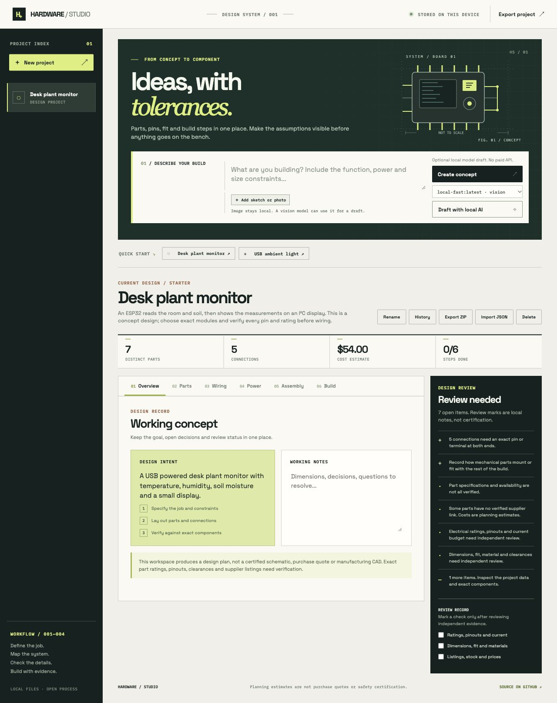

# Hardware Studio

An original, local-first hardware design workspace informed by a public study of [Blueprint.io](https://www.blueprint.io/). It helps turn a small electronics idea into an editable project brief, parts list, connection map, conceptual assembly view, build sequence, and review record. It does not copy Blueprint's code, graphics, brand, private data, or generated project packages.

**[Open the live app](https://nazeeh111.github.io/hardware-studio-skill/)** · [Read the design analysis](./BLUEPRINT_ANALYSIS.md) · [Use the Codex skill](./skills/hardware-studio/SKILL.md)



[View the narrow layout](assets/studio-narrow.png).

For a dimensioned example, see the [Pico + NeoPixel prototype tray](examples/pico-neopixel-tray/README.md): editable OpenCascade source, STEP and STL exports, a Blender scene, a fit report checked against two original manufacturer STEP models, and a provisional electrical path. Its [connection register](examples/pico-neopixel-tray/connections.csv) separates 26 proposed conductor paths; 21 still lack at least one exact endpoint. The proposed 5 V / 2 A source is listed, while the power worksheet flags missing load and branch evidence. It remains a prototype with documented open checks.

To create a new rectangular tray and optional separate lift-off cover, use the [parametric tray generator](tools/tray-generator/README.md) with a millimeter JSON specification. It exports fresh STEP, STL and a dimensioned layout, then reopens the exports in a separate process to check their integrity and nominal lid/tray intersection. Component fit and fabrication checks still need separate evidence.

For exact component STEP files, the same tool folder includes a [fit checker](tools/tray-generator/README.md#check-supplied-component-step-models). Give it explicit model placements; it reports tray/component and component/component intersections, closest distances, envelope margins and source hashes. A clear nominal model report still needs hardware and fabrication checks.
The [Pico + NeoPixel worked package](examples/pico-neopixel-tray/README.md#reusable-fit-checker) includes both a nominal manufacturer-model report and a deliberately shifted board that the checker detects as a collision. Manufacturer CAD is linked, not redistributed.

The [tray workbench](tray.html) provides a scaled browser plan and controls for dimensions, bosses, locators, through-holes, edge openings and an optional lift-off cover with an outside skirt. It saves a valid draft with its project, in project JSON, and as `tray-spec.json` in a project ZIP. Run `sh tools/tray-generator/run-local.sh --port 4174` and open `http://127.0.0.1:4174/tray.html` to generate and download tray and cover STEP/STL using local OpenCascade. On that local origin, you can choose up to four exact-part STEP models, enter their source-axis orientation and measured X/Y/Z placement, and download a nominal collision report against the tray and seated cover. The selected STEP files go only to the loopback server and are removed from its temporary directory after the check. The launcher uses this Mac's installed OCP environment, an OCP-enabled `python3`, or `HARDWARE_STUDIO_PYTHON` when set. The browser preview, generated geometry and clear fit report are not physical-fit checks. GitHub Pages can prepare the spec but cannot execute Python.

## Run

From this folder:

```sh
python3 -m http.server 4173
```

Open `http://localhost:4173` in a browser. No account, paid API or server database is required. Projects and recent revisions stay in that browser's local storage. Export JSON regularly for a durable copy; clearing browser data removes local projects and history. The interface fetches Google Fonts when online; it falls back to local system fonts offline.

Optional local AI drafting uses an already installed [Ollama](https://docs.ollama.com/api/generate) model at `127.0.0.1:11434`. Start Ollama before opening the app, select a local model, enter a brief, and choose **Draft with local AI**. Add a sketch or photo if useful; image drafting requires a model marked **vision** in the selector. If Ollama is unavailable, the editor and starter designs still work. The brief and optional resized image go only to the local Ollama service; no cloud model is called by this feature. Generation uses local compute and can take a few minutes.

For local AI, run the app at `http://127.0.0.1:4173` so the browser can use Ollama's default local-origin access. The public GitHub Pages version works without Ollama; its AI control stays hidden unless your Ollama installation explicitly allows that site's origin.

## What works

- Start from the filled plant monitor or ambient-light designs, or create a blank concept from any brief. The **Create concept** button records the brief and optional image without claiming automatic design; choose a starter explicitly to use its example parts and wiring.
- After entering an idea, answer up to four focused design questions about the relevant load, measurement, visible output, power, size or operating conditions. The success check is always included. Answers and unanswered questions become part of the saved brief and the optional local-model prompt, so missing specifications stay visible. This guided intake uses local rules; it is not Blueprint's private follow-up system or a substitute for engineering measurements.
- Optionally draft an arbitrary low-voltage concept with a local Ollama model. The model output must pass structural checks; the app clears any claimed prices, supplier links and verification marks, then shows the proposed parts for review before adding it to the workspace. A Pico/RP2040 plus NeoPixel brief requires an explicit LED power source; a named 5 V version also requires a logic-level interface. This gate catches one observed omission and is not an electrical design review.
- The local draft preview exposes proposed parts, part-level connections, build steps and open review checks before acceptance. It is a concept review surface, not a verified schematic or proof that the suggested components meet the brief.
- Add a JPEG, PNG or WebP sketch or photo to a brief. The browser redraws it as a JPEG under 250 KB, stripping original image metadata, and keeps it with the project in local storage and exports. A local vision model can use it as reference; its interpretation, measurements and hidden details remain unverified.
- Add, edit and remove parts, connections and build steps. Connections can record exact pins or terminals at both ends; missing endpoints remain visible review items. Removing a part also removes its associated connections and power loads. A checked part records a specification link and check date; imported check marks reset for review.
- Track quantities and planning cost estimates, and export the bill of materials as CSV.
- View and export a connection diagram and a conceptual component index as SVG. Export `connections.csv` to review each relationship, named endpoints and its pin-inventory status; a row may still combine multiple conductors, so it is not a schematic. Record separate mounting and fit relationships between physical parts; those notes remain unverified until checked against dimensioned CAD and actual hardware.
- Record a part's known pin or terminal names, then choose those names in the connection editor. The app and skill checker flag a wire endpoint absent from the selected part's recorded inventory. An empty or internally consistent inventory does not verify the maker pinout, voltage domain, conductor rating or schematic.
- Build a part-linked checklist with separate tools and prerequisites. The project ZIP includes `build-plan.txt`; the app flags steps linked to deleted or missing parts. A checklist is still a plan until its operations are checked on exact hardware.
- Attach a link to a separate dimensioned CAD and verification package; the Assembly view keeps that evidence distinct from its conceptual drawing.
- Open a project-specific tray workbench from Assembly to create and download an editable millimeter spec. Its scaled plan helps place features; the local server can produce tray and optional cover STEP/STL and compare supplied STEP models against both at the seated cover pose.
- Record multiple power rails, their rated supply current, assigned part loads and a headroom target. The worksheet multiplies per-unit peak current by part quantity and flags missing values, overloads and low margin.
- Record notes, completion and independent review marks. Errors such as connections to missing parts are highlighted.
- Keep multiple projects locally; import/export project JSON. Imported review marks reset until the imported design is checked again.
- Export a ZIP with project JSON, bill of materials, connection and mounting CSVs, conceptual wiring and assembly SVGs, current review findings, a short README and the resized visual reference when present. Linked electrical or CAD evidence stays external; this export does not claim to include verified manufacturing files.
- Open **History** to restore a recent edit or recover a deleted project while its local snapshot remains. The app retains up to 12 earlier states per project within a shared 2 MB history limit; restoration saves the current state first and resets verification and completed-step marks. Deletion is cancelled when its recovery snapshot cannot be stored. If saved workspace data becomes unreadable, the app preserves its original bytes and offers a download before allowing a fresh workspace.

## Limits that matter

The browser app does **not** generate a verified schematic, manufacturing CAD, live prices, supplier stock, firmware or safety certification. The separate tray generator produces a limited class of parametric CAD; its output does not establish physical fit or fabrication readiness. The Pico example has separate manufacturer-model checks but still has no physical fit or fabrication review. Local AI drafts are unverified concepts and may contain wrong or missing parts and connections. App diagrams show relationships and part inventory. The power worksheet covers only the loads assigned to each rail and does not check voltage compatibility, startup surges, cable or connector ratings, or regulator heat. Review the exact component datasheets and supplier listings before buying parts or connecting power. The starter prices are illustrative, not current quotations.

The [Blueprint analysis](./BLUEPRINT_ANALYSIS.md) separates directly observed public behavior from Blueprint's own statements and unknown implementation details. The [hardware design skill](./skills/hardware-studio/SKILL.md) guides Codex through a more rigorous end-to-end design workflow and can use appropriate local CAD tools when a dimensioned model is requested.

For ideas beyond the built-in starters, ask Codex to use the skill to create a project JSON file. Check the file with the skill's `scripts/check-project.mjs`, then import it in the app. The structural check does not replace review of actual hardware.

## Checks

```sh
npm test
```

The Node tests cover cost arithmetic, broken references, CSV quoting, import boundaries, local-model output and power-budget calculations. Visual and interaction checks should be performed in a browser after changes.

## License

MIT. This license applies to this original repository and does not grant rights to Blueprint's site, name, content or product.
