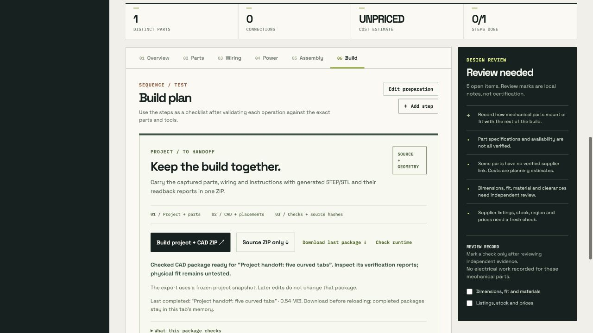
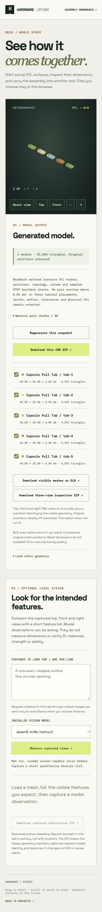

# Hardware Studio

**From an idea to an editable, inspectable hardware package.**

Plan parts, wiring and build steps. Give parts real geometry. Keep the captured sources and check reports with the handoff.

[Open the app](https://nazeeh111.github.io/hardware-studio-skill/) · [Capability guide](docs/CAPABILITY_GUIDE.md) · [Blueprint study](BLUEPRINT_ANALYSIS.md) · [Reusable skill](skills/hardware-studio/SKILL.md)


An original open-source workspace informed by a public study of [Blueprint.io](https://www.blueprint.io/). It runs without a paid API. Your project stays in browser storage; optional AI and CAD run through local services.

## What you can do

| Stage | Tools | What the result means |
| --- | --- | --- |
| Define | Brief, follow-up questions, photos and editable sketches | Captured constraints and assumptions |
| Plan | Parts, pin/terminal connections, mounting intent and a power worksheet | Editable records with explicit missing evidence |
| Model | Boxes, cylinders, polygon/line/arc extrusions and selected-edge fillets; per-part sources and rigid placements | Bounded geometry with editable operation history |
| Check | Fresh STEP readback, material/void probes, mesh checks, interference and three-view inspection | Nominal software checks with retained reports |
| Revise | Manual edits, local AI proposals, optional geometry check before applying, history and conflict recovery | Captured changes that preserve unrelated work |
| Handoff | Source-only ZIP or one captured project + checked CAD ZIP | Sources, generated files and hashes kept together |

Optional local vision supplies qualitative observations of captured mesh views. Model text is separate from geometry checks and never certifies a project. See [the complete workflow and limits](docs/CAPABILITY_GUIDE.md).

## Run

The app has no frontend build step or package dependencies.

```sh
git clone https://github.com/nazeeh111/hardware-studio-skill.git
cd hardware-studio-skill
python3 -m http.server 4173 --bind 127.0.0.1
```

Open `http://127.0.0.1:4173/`. The public site and this static server support manual editing, imports, source exports and mesh inspection. AI proposals require a running local Ollama service and an installed local model.

For native CAD generation on the tested **macOS arm64 / Python 3.12** setup:

```sh
sh tools/cad-runtime/setup.sh
sh tools/tray-generator/run-local.sh --port 4174
```

Open `http://127.0.0.1:4174/`. The optional project runtime occupies about 730 MB. Other platforms need their own verified runtime. Existing OCP environments can support the legacy shapes. See [runtime setup and fallback](tools/cad-runtime/README.md).

## One project and CAD handoff

In **Build**, choose **Build project + CAD ZIP** on the local CAD server. It captures one project, builds every recorded CAD branch, reopens the exports, and packages the result with the original source ZIP and a file-hash manifest. Any rejected branch prevents a new combined package. Recorded interference remains clearly labeled and downloadable.

**Export source ZIP** works without native CAD. Later edits do not change an earlier completed download. Download retained results before reloading the tab.



[Inspect the actual three-branch browser package](examples/project-cad-handoff/README.md) · [Compiler contract](tools/project-generator/README.md)

## Check a proposal before replacing the source

In the local solid modeler, review the model’s proposed source and choose **Check proposed geometry**. The native builder runs against that captured proposal while your working part stays unchanged. The result separates geometry figures from source and evidence details. **Apply** remains a separate action. A changed request or project makes the old proposal stale.

[Read the actual model trial, retained failures and independent checks](examples/proposal-geometry-check/README.md).

## Worked examples

These retain actual artifacts and repeatable checks, including failed or incorrect cases.

| Example | Inspect |
| --- | --- |
| [Curved pull tab](examples/curved-pull-tab/README.md) | Actual local-model proposal, exact arcs and top fillet, independently derived geometry checks, five placed instances and GLB |
| [Placed assembly](examples/placed-assembly/README.md) | Plate and standoffs, rotations, pairwise clearance, wrong-placement controls |
| [Pico + NeoPixel tray](examples/pico-neopixel-tray/README.md) | STEP/STL, manufacturer-model fit checks, Blender source and a provisional electrical plan |
| [Captured handoff](examples/project-cad-handoff/README.md) | All three CAD branches, source identity, failed-build retention and explicit interference |
| [Local vision observation](examples/vision-observation/README.md) | Exact captured views, model request/output, cancellation and accuracy limits |



## Limits that matter

Geometry is nominal. Software checks do not establish physical fit, fabrication tolerances, materials, strength, electrical behavior or safety. Parts, prices, ratings and wiring need independent evidence. There is no live sourcing service, firmware generator, joint/motion solver or manufacturing service.

Public drafts share this GitHub host’s browser storage with sibling sites. Use a local origin for sensitive work. GitHub Pages cannot run native CAD or local AI. The [Blueprint study](BLUEPRINT_ANALYSIS.md) separates direct observations, published claims and unknown private behavior; this project does not establish Blueprint feature parity.

## Checks

```sh
npm test
```

Run native checks with the corresponding [CAD tool guides](docs/CAPABILITY_GUIDE.md). The [audit](AUDIT.md), [text-to-CAD research](research/TEXT_TO_CAD.md) and example verifiers retain revision-specific evidence and its limits. A passing test is not a hardware validation.

To create an importable project with the [Hardware Studio skill](skills/hardware-studio/SKILL.md), validate its structure before importing:

```sh
node skills/hardware-studio/scripts/check-project.mjs /absolute/path/to/project.json
```

The structural checker does not validate electrical or mechanical engineering.

## License

MIT for this original repository. It does not grant rights to Blueprint’s code, name, graphics or content.
