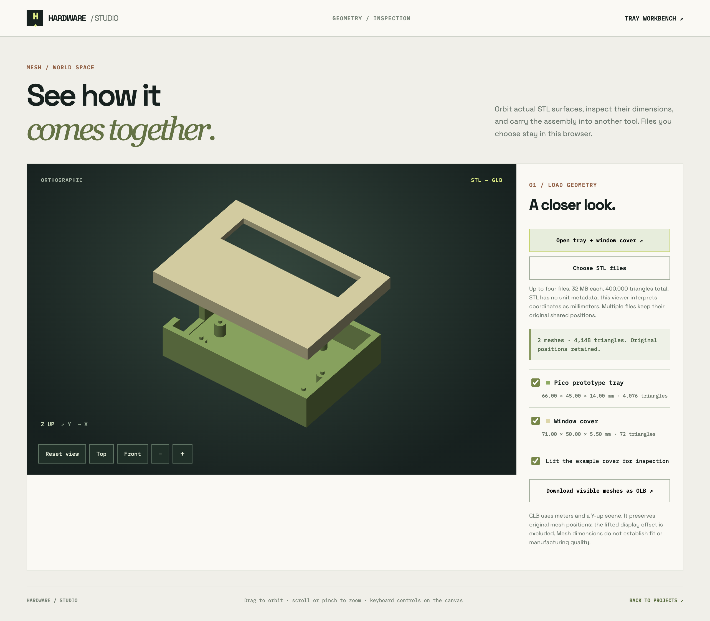

# Hardware Studio

An original, local-first hardware design workspace informed by a public study of [Blueprint.io](https://www.blueprint.io/). It helps turn a small electronics idea into an editable project brief, parts list, connection map, conceptual assembly view, build sequence, and review record. It does not copy Blueprint's code, graphics, brand, private data, or generated project packages.

**[Open the live app](https://nazeeh111.github.io/hardware-studio-skill/)** · [Read the design analysis](./BLUEPRINT_ANALYSIS.md) · [Review checks and open gaps](./AUDIT.md) · [Use the Codex skill](./skills/hardware-studio/SKILL.md)


[View the narrow layout](assets/studio-narrow.png) or [phone layout](assets/studio-phone.png).

For a dimensioned example, see the [Pico + NeoPixel prototype tray](examples/pico-neopixel-tray/README.md): editable OpenCascade source, STEP and STL exports, a Blender scene, a fit report checked against two original manufacturer STEP models, and a provisional electrical path. Its [connection register](examples/pico-neopixel-tray/connections.csv) separates 28 proposed conductor paths; six still lack a named endpoint, while 17 use assembly-assigned labels that need a physical hole map. The proposed 5 V / 2 A source, two separate five-position splices, off-tray shifter carrier and 22 AWG wire are listed, while the power worksheet flags missing load and branch evidence. It remains a prototype with documented open checks.
The [open-window cover revision](examples/pico-neopixel-tray/README.md#open-window-cover-revision) cuts a measured aperture above the modeled Stick and retains the lid STEP, readback, maker-model fit report and Blender scene. It does not include a diffuser or verified optical design.

To create a new rectangular tray and optional separate lift-off cover, use the [parametric tray generator](tools/tray-generator/README.md) with a millimeter JSON specification. It exports fresh STEP, STL and a dimensioned layout, then reopens the exports in a separate process to check their integrity and nominal lid/tray intersection. Component fit and fabrication checks still need separate evidence.

For exact component STEP files, the same tool folder includes a [fit checker](tools/tray-generator/README.md#check-supplied-component-step-models). Give it explicit model placements; it reports tray/component and component/component intersections, closest distances, envelope margins and source hashes. A clear nominal model report still needs hardware and fabrication checks.
The [Pico + NeoPixel worked package](examples/pico-neopixel-tray/README.md#reusable-fit-checker) includes both a nominal manufacturer-model report and a deliberately shifted board that the checker detects as a collision. Manufacturer CAD is linked, not redistributed.

The [3D inspection viewer](cad-viewer.html) opens the actual tray and window-cover STL surfaces, or up to four local STL files. Orbit, zoom, use top/front views, toggle meshes and lift the example cover. Mesh bounds are shown in millimeters; STL itself has no units. Download visible meshes as GLB in meters at their original positions. The [worked GLB](examples/pico-neopixel-tray/generated/window-cover-v1/assembly.glb) was downloaded from the browser and independently imported into Blender 5.1.2: two meshes, 4,148 faces and the expected dimensions. See its [readback](examples/pico-neopixel-tray/generated/window-cover-v1/glb-readback.json). This is mesh inspection, without arbitrary CAD generation or a fit solver. The viewer also downloads a three-view inspection ZIP: top/front/right PNG views at one pixel scale and a manifest identifying the visible render geometry. It preserves original positions and excludes hidden meshes and the display-only cover lift. See the [actual profile-plate export](examples/profile-plate/inspection/inspection.png) and [identity manifest](examples/profile-plate/inspection/inspection.json). This is a surface inspection sheet, not a dimensioned drawing or an AI verdict. In the loopback-hosted viewer, optional local vision compares that captured image with 1–8 qualitative feature lines. It records only advisory visible/not-visible/unclear observations. The ZIP retains the exact image, geometry hashes, captured request, selected model digest and raw response. Changed requests or viewer states mark older results explicitly; canceled retries keep the preceding completed result available. The conservative request checker rejects recognized measurement and physical-property terms before the model call; it does not understand every possible phrasing. No CAD or project review marks are changed. See the [completed and canceled browser trials](examples/vision-observation/README.md). Results stay in tab memory and must be downloaded before reload.



On the local CAD server, the workbench's **Generate and inspect in 3D** action opens a fresh tray/cover directly in the viewer. A frozen specification stays in the current tab's session storage for 30 minutes. The server generates STEP/STL and reopens them; the browser checks STL hashes, triangle counts and dimensions against that readback before displaying the meshes. The viewer can regenerate the CAD ZIP from those same dimensions. GitHub Pages provides static inspection and spec editing; generation needs the local server. Restart an older local server to enable this feature. [View the custom generated preview](assets/generated-preview.png).

The [tray workbench](tray.html) provides a scaled browser plan and controls for dimensions, bosses, locators, through-holes, edge openings and an optional lift-off cover with an outside skirt and measured light opening. It saves a valid draft with its project, in project JSON, and as `tray-spec.json` in a project ZIP. Run `sh tools/tray-generator/run-local.sh --port 4174` and open `http://127.0.0.1:4174/tray.html` to generate and download tray and cover STEP/STL using local OpenCascade. On that local origin, you can choose up to four exact-part STEP models, enter their source-axis orientation and measured X/Y/Z placement, and download a nominal collision report against the tray and seated cover. The selected STEP files go only to the loopback server and are removed from its temporary directory after the check. The launcher uses this Mac's installed OCP environment, an OCP-enabled `python3`, or `HARDWARE_STUDIO_PYTHON` when set. The browser preview, generated geometry and clear fit report are not physical-fit checks. GitHub Pages can prepare the spec but cannot execute Python.

## Feature solids beyond trays

The [solid modeler](solid.html) builds connected parts from ordered box/cylinder additions and cuts and simple polygon extrusions, with a dimension editor, editable source and optional local text proposals. It supports selected material/void checks, checked STEP/STL packages and the existing 3D viewer/GLB export. A [three-hole bracket example](examples/feature-bracket/README.md) matches an independently calculated volume and catches missing hole cuts. A [concave profile plate](examples/profile-plate/README.md) adds custom outlines, selected profile checks and an analytical volume comparison. Edit sizes, positions, operations and polygon points in the dimension controls; the expandable JSON editor retains the same source. Pending changes must be applied before Undo/Redo or generation. See the [format and CLI guide](tools/solid-generator/README.md).

Open the modeler from a project’s Assembly tab to keep its applied source as `solidSpec` in that project. Project JSON and ZIP exports retain it, with `solid-spec.json` in the ZIP; checked STEP/STL is downloaded separately from the modeler. History restoration updates both project and workbench source, and imported projects get an independent model identity. Opening the example does not attach it until you apply or import source. The direct modeler link keeps a separate standalone draft. Polygon profiles support custom straight-edged outlines and positive-axis extrusion. They do not cover curved or multiply connected sketches, fillets, threads, lofts or assemblies. A valid source becomes geometry only after generation and readback. Physical engineering checks remain open.

## Run

From this folder:

```sh
python3 -m http.server 4173 --bind 127.0.0.1
```

Open `http://127.0.0.1:4173` in a browser. No account, paid API or server database is required. Projects and recent revisions stay in that browser's local storage. Export JSON regularly for a durable copy; clearing browser data removes local projects and history. The public GitHub Pages app stores data on the `nazeeh111.github.io` browser origin, which is shared with other sites under that same host. Use the loopback version for sensitive drafts. The interface fetches Google Fonts when online; it falls back to local system fonts offline.

Optional local AI drafting uses an already installed [Ollama](https://docs.ollama.com/api/generate) model at `127.0.0.1:11434`. Start Ollama before opening the app, select a local model, enter a brief, and choose **Draft with local AI**. Add a sketch or photo if useful; image drafting requires a model marked **vision** in the selector. If Ollama is unavailable, the editor and starter designs still work. The brief and optional resized image go only to the local Ollama service; no cloud model is called by this feature. Generation uses local compute and can take a few minutes.

The model picker checks each installed model with Ollama's `/api/show` endpoint. `/api/tags` alone does not consistently report vision capability. In a local image test, `qwen3-vl:4b-instruct` recognized the prototype render but returned an incomplete concept that the app rejected; `local-fast:latest` produced a five-part concept, two proposed connections and eight steps that passed the structural gate. The [local test screenshot](vision-draft-local.png) shows the saved draft with its image. That draft omitted an explicit LED supply/return path; the revised [review view](vision-power-review-local.png) now names this gap. These earlier checks confirm the image flow and review warning on that machine, not part selection or electrical correctness. The later [coordinated drafting trials](examples/coordinated-drafts/README.md) retain an actual JSON download, a rejected step-link response and a stale-request acceptance check; they also document a bad fabrication suggestion that passed structural validation.

For local AI, run the app at `http://127.0.0.1:4173` so the browser can use Ollama's default local-origin access. The public GitHub Pages version works without Ollama and does not probe the local model service. Local AI controls are available only on a loopback host; cloud-named model tags are excluded. The selected model is retained in the current tab.

## Revise an existing project

In the local app with Ollama ready, choose **Revise with local AI** beside the project title. Describe the requested change, select a model, and inspect the before/after records. Parts, connections, mounting, power-rail bindings, linked steps, tools and assumptions can change together. The model returns up to 32 explicit edits against the captured project. Unmentioned records, existing CAD, images and evidence links remain attached.

Changing a part's identity clears its recorded price, pin inventory and specification checks; quantity-only changes retain the per-unit part evidence. Affected steps and all project review marks reset. Changed rails have unknown currents, and wire changes conservatively clear affected load-current evidence while preserving unchanged supply hardware ratings and unrelated branch currents. These rules prevent some stale records; they do not validate a design. Expand each changed record to inspect every automatic reset. Free-form model explanations remain in the raw downloaded patch; saved project provenance is derived from the recorded edit operations, so unsupported model claims of completed tests are not appended as project notes.

**Download revision ZIP** retains the captured project, proposed project and exact model patch with its before/after record. Importing the proposed JSON creates a separate project with checks reset. **Apply reviewed revision** first saves a recovery snapshot in History, then saves the new state. A changed request, model, workspace or CAD sidecar blocks an older proposal. Close and reopen to capture the latest project. Requests survive close/reopen in memory and reload when tab storage works; saved text needing recovery is preserved until downloaded and explicitly replaced.

The model receives design fields and original record indexes, without image pixels, CAD source or dedicated source/evidence fields. Geometry edits belong in the workbenches. Large projects exceeding the local context bound use the manual editor; appending a change is rejected if existing notes plus the request would exceed 10,000 characters. See the [actual revision trials](examples/project-revision/README.md) for retained model patches, source-preservation checks and a blocked concurrent CAD case.

## What works

- Start from the filled plant monitor or ambient-light designs, or create a blank concept from any brief. The **Create concept** button records the brief and optional image without claiming automatic design; choose a starter explicitly to use its example parts and wiring.
- After entering an idea, answer up to four focused design questions about the relevant load, measurement, visible output, power, size or operating conditions. The success check is always included. Answers and unanswered questions become part of the saved brief and the optional local-model prompt, so missing specifications stay visible. The brief text and answers survive reload in the same tab when session storage is available. Unreadable saved request bytes are preserved until downloaded and explicitly replaced. This guided intake uses local rules; it is not Blueprint's private follow-up system or a substitute for engineering measurements.
- Optionally draft an arbitrary low-voltage concept with a local Ollama model. The model output must pass structural checks; the app clears any claimed prices, supplier links and verification marks, then shows the proposed parts for review before adding it to the workspace. A Pico/RP2040 plus NeoPixel brief requires an explicit LED power source; a named 5 V version also requires a logic-level interface. This gate catches one observed omission and is not an electrical design review.
- The local draft preview exposes proposed parts, connection and mounting intent, tools, assumptions, part-linked build/test steps, proposed power rails and open review checks before acceptance. Supply and load currents remain unknown, so generated budgets cannot pass as verified. Download draft JSON before accepting or discarding if you need a copy. A changed brief, answer or reference blocks acceptance of an older response and preserves the newer input. Targeted review warnings flag a lighting part missing supply/return, a sensor without a clear signal/data path, a rail naming an interconnect as its source, and a simple voltage-note discrepancy. These are partial heuristics; all review items can be expanded in the rail. It is a concept review surface, not a verified schematic or proof that the suggested components meet the brief.
- Add a JPEG, PNG or WebP sketch or photo to a brief. The browser redraws it as a JPEG under 250 KB, stripping original image metadata, and keeps it with the project in local storage and exports. A local vision model can use it as reference; its interpretation, measurements and hidden details remain unverified.
- Choose **Draw sketch** for pen, eraser, labels, ink colors, undo/redo and an optional drawing grid. Unfinished strokes and the pending reference survive reload in the same tab when session storage is available. Use the sketch to attach it, then create a project; saved projects retain editable strokes and an **Edit sketch** action. JSON and ZIP exports keep the source, with `reference-sketch.json` alongside the grid-free JPEG. Only the JPEG is sent to a selected local vision model. Labels and the grid do not establish measurements or ratings.
- Add, edit and remove parts, connections and build steps. Connections can record exact pins or terminals at both ends; missing endpoints remain visible review items. Removing a part also removes its associated connections and power loads. A checked part records a specification link and check date; imported check marks reset for review.
- Track quantities and planning cost estimates, and export the bill of materials as CSV.
- View and export a connection diagram and a conceptual component index as SVG. Export `connections.csv` to review each relationship, named endpoints and its pin-inventory status; a row may still combine multiple conductors, so it is not a schematic. Record separate mounting and fit relationships between physical parts; those notes remain unverified until checked against dimensioned CAD and actual hardware.
- Record a part's known pin or terminal names, then choose those names in the connection editor. The app and skill checker flag a wire endpoint absent from the selected part's recorded inventory. An empty or internally consistent inventory does not verify the maker pinout, voltage domain, conductor rating or schematic.
- Build a part-linked checklist with separate tools and prerequisites. The project ZIP includes `build-plan.txt`; the app flags steps linked to deleted or missing parts. A checklist is still a plan until its operations are checked on exact hardware.
- The Assembly view groups saved editable CAD source, linked external evidence and a component index with illustrative symbols. Full part names remain readable; mechanical plates, feet, brackets and spacers have distinct family symbols. These symbols are not generated geometry and are never automatically bound to project CAD. Attach a separate CAD package URL to retain its evidence link.
- Open a project-specific tray workbench from Assembly to create and download an editable millimeter spec. Its scaled plan helps place features; the local server can produce tray and optional cover STEP/STL and compare supplied STEP models against both at the seated cover pose.
- In the local tray workbench, describe parameter changes to a selected installed Ollama model, review its complete proposed spec and assumptions, then apply it to the dimension fields. A changed form invalidates the proposal. The model returns parameter JSON; the separate CAD action builds and checks the geometry. This covers supported trays, not arbitrary text-to-CAD. See the [source comparison and design decision](research/TEXT_TO_CAD.md) and [actual local trial CAD package](examples/text-edited-tray/README.md).
- Record multiple power rails, their rated supply current, assigned part loads and a headroom target. The worksheet multiplies per-unit peak current by part quantity and flags missing values, overloads and low margin.
- Record notes, completion and independent review marks. Errors such as connections to missing parts are highlighted.
- Keep multiple projects locally; import/export project JSON. Imported review marks reset until the imported design is checked again.
- Export a ZIP with project JSON, bill of materials, connection and mounting CSVs, conceptual wiring and assembly SVGs, current review findings, a short README and the resized visual reference when present. Linked electrical or CAD evidence stays external; this export does not claim to include verified manufacturing files.
- A tab refuses to save when the workspace changed since it loaded or last saved. Download its attempted-workspace backup, then reload and reconcile individual projects. This stale-tab guard is not collaborative editing. The tray workbench similarly preserves unreadable or externally changed draft bytes and requires a backup download before explicit replacement.
- Open **History** to restore a recent edit or recover a deleted project while its local snapshot remains. The app retains up to 12 earlier states per project within a shared 2 MB history limit; restoration saves the current state first and resets verification and completed-step marks. Deletion is cancelled when its recovery snapshot cannot be stored. If saved workspace data becomes unreadable, the app preserves its original bytes and offers a download before allowing a fresh workspace.

## Limits that matter

The browser app does **not** generate a verified schematic, manufacturing CAD, live prices, supplier stock, firmware or safety certification. The separate tray generator produces a limited class of parametric CAD; its output does not establish physical fit or fabrication readiness. The Pico example has separate manufacturer-model checks but still has no physical fit or fabrication review. Local AI drafts are unverified concepts and may contain wrong or missing parts and connections. App diagrams show relationships and part inventory. The power worksheet covers only the loads assigned to each rail and does not check voltage compatibility, startup surges, cable or connector ratings, or regulator heat. Review the exact component datasheets and supplier listings before buying parts or connecting power. The starter prices are illustrative, not current quotations.

The [Blueprint analysis](./BLUEPRINT_ANALYSIS.md) separates directly observed public behavior from Blueprint's own statements and unknown implementation details. The [hardware design skill](./skills/hardware-studio/SKILL.md) guides Codex through a more rigorous end-to-end design workflow and can use appropriate local CAD tools when a dimensioned model is requested.

For ideas beyond the built-in starters, ask Codex to use the skill to create a project JSON file. Check the file with the skill's `scripts/check-project.mjs`, then import it in the app. The structural check does not replace review of actual hardware.

## Checks

```sh
npm test
```

The Node tests cover cost arithmetic, broken references, CSV quoting, import boundaries, local-model output and power-budget calculations. Visual and interaction checks should be performed in a browser after changes.

## License

MIT. This license applies to this original repository and does not grant rights to Blueprint's site, name, content or product.
