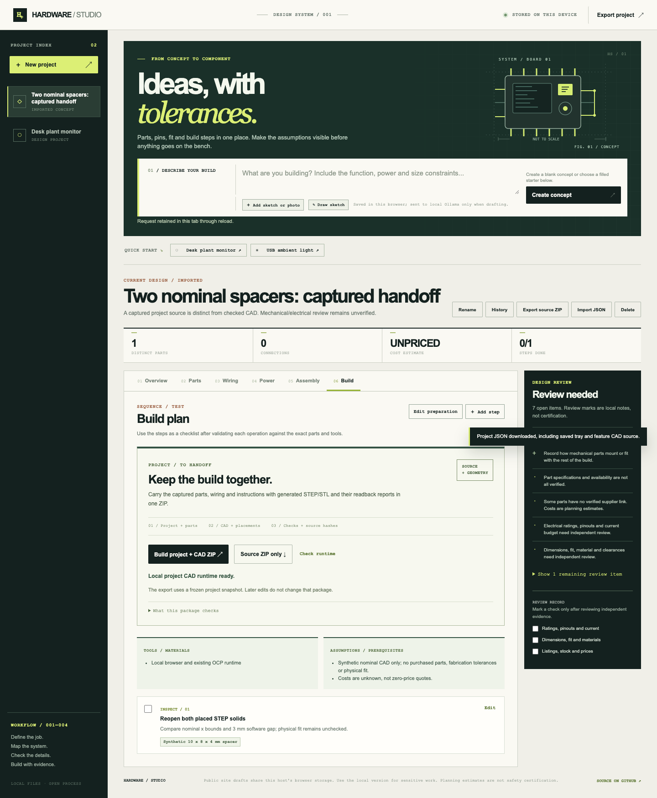

# Valid structure is not verified clearance

This is an actual offline current-main workflow with synthetic geometry, not a fabricated device or model demonstration. One parts-list asset has two nominal 10 × 8 × 4 mm instances. The source checker accepts both placements below. Their CAD meaning differs.

| Case | Second X position | Reopened nominal result |
| --- | --- | --- |
| Actual browser-captured package | 13 mm | 3 mm minimum gap; status `passed` |
| Separate standalone assembly control | 9 mm | 32 mm³ overlap; status `interference` |

The control is a completed, labeled geometry result, not a rejected schema or an acceptable physical fit. Both retain two valid nominal solids. Same-kernel fresh STEP inspection corroborates the analytic box dimensions, each volume 320 mm³, and the placement difference. No tolerances, materials, strength, physical hardware or electrical behavior were validated.

[Exact case](case.json) · [Native CAD manifest](cad-manifest.json) · [Native readback](cad-readback.json) · [Separate direct inspection](independent-readback.json) · [Control source](control-spec.json) · [Control readback](control-readback.json) · [Wide SVG](handoff.svg) · [Phone SVG](handoff-mobile.svg)

## Follow the capture

1. A new isolated browser imported [this captured project](captured-project.json), then exported source and used **Build project + CAD ZIP** on an owned loopback server. The downloaded [checked CAD ZIP](checked-cad.zip) has 24 members and 23 manifest-hashed payloads.
2. Its exact nested [captured-source.zip](captured-source.zip) has 11 entries. All are also preserved byte for byte at the outer package root. The source capture SHA is `70ac0e0d8164659ec89c75d76c18ab5edd1604c53d97ca0fb7b88b9891103d76`.
3. Source and native geometry remain separate artifacts. The parts are unpriced synthetic records, review marks stay false and the plan remains unverified.
4. A later browser note edit produced [this separate project](later-project.json). It changed notes and the update timestamp, without changing the earlier completed CAD package. Export-only ZIPs and native captures can have different ZIP timestamps; their complete archive bytes need not match.
5. Invalid JSON import retained the valid project exactly. Fresh desktop and true-phone contexts reopened the saved project. The native CLI also refused an already-existing destination without changing the earlier download.



## Check and repeat

From the full repository, without optional CAD or model dependencies:

```sh
node skills/hardware-studio/scripts/check-project.mjs docs/presentation/captured-project.json
node skills/hardware-studio/scripts/check-project.mjs docs/presentation/control-project.json
python3 -B docs/presentation/check.py
```

The Node checker verifies project shape and links, not mechanical or electrical engineering. The stdlib reader checks the actual ZIP manifest, original source capture, all root/nested identities and the retained result fields. It does not independently reopen CAD unless `--cad` is supplied with a matching OCP-enabled Python. That optional check directly reads placed STEP files, computes volumes, separation and overlap using OpenCascade, separately from Studio's builder. It is still the same kernel family, not independent-kernel or physical validation.

[Download the self-contained native example](worked-example.zip). Its archive-specific README gives exact local paths and prerequisites. All trusted compiler Python sources and skill checker modules needed by the included commands are retained. No full app or model is bundled. With the existing documented OCP fallback, the native CLI rebuilds from captured-source.zip into a new absent output path. Fresh STEP headers and timing fields can differ; compare captured source identity, nominal geometry and outcomes.

## Capability and host boundaries

The repository contains a real static browser workspace, a reusable skill, structural validators and local CAD tools. The skill is guidance and a data contract, not a hosted CAD API. Host loading/installation is separate; source discovery, a checkout or a successful CLI check does not establish installed native acceptance.

The actual run reused the documented existing OCP 8.0.1.1.0 / Python 3.12.14 fallback, read-only. No build123d was installed, so this demonstrates simple boxes and rigid placements, not curved profiles or fillets. The separately pinned full runtime is a different prerequisite. See [runtime selection](../../tools/cad-runtime/README.md), [compiler contract](../../tools/project-generator/README.md) and [complete capability guide](../CAPABILITY_GUIDE.md).

All assets and records are task-owned synthetic inputs. No model, account, paid API, hardware, credentials or real device files were used. Source checks and nominal CAD do not validate fabrication, electrical safety, procurement, instructions or a physical build. The original project's deeper examples, license, retained failures and prior captures remain unchanged.
