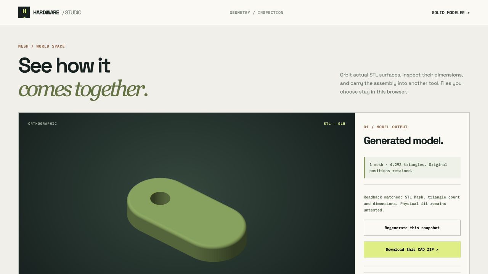

# Curved pull tab: actual local text-to-CAD trial



A separately captured **qwen3.8:27b** request produced an exact line/arc extrusion, one D6 bore and a top outer R1 fillet. The [captured proposal](model-27b/proposal.json) records the complete request, raw response and model digest checked before and after inference. The first **qwen3-vl:4b-instruct** attempt produced invalid geometry data, was rejected and applied nothing; its [actual rejected proposal](model-rejected/proposal.json) is retained. This is one two-attempt case, not a comparative model benchmark or a guarantee for other prompts.

## Retained artifacts

- [Final browser CAD ZIP](final-cad.zip) and [unpacked source](final-cad/spec.json), [build history](final-cad/build-report.json), [fresh readback](final-cad/verification.json).
- The earlier [checked browser package](checked-cad.zip), used in the initial independent review. Its geometry and source match the final package; the final report additionally retains the export normalization receipt.
- [Independent intent verifier](verify_intent.py) and [report](intent-verification.json). It reads actual STEP with OCP directly, without importing the Studio builder or its verification helpers.
- [Five-instance project](five-tabs-project.json), [actual assembly CAD download](five-tabs-cad.zip), [GLB](five-tabs.glb), [inspection ZIP](five-tabs-inspection.zip), [export replay](verify_exports.mjs) and [result](export-verification.json).

## Requested geometry and independent checks

The outer profile has two straight segments and two exact R10 semicircles: X0–40, Y0–20, Z0–6 mm. The D6 through-bore is centered at (10,10). Four explicit edge seeds select the complete top outer contour for R1 rounding. The bore and bottom perimeter remain unrounded. The accepted source supplied no region probes; the independent verifier adds ten separate material/void regions rather than claiming the model generated them.

The analytic face inventory confirms the outer R10 semicylinders, R3 bore and its axis/location/full height, top R1 cylinders and R9/R1 torus patches, top inset and intact bottom. Separate wrong-shape controls preserve volume but shift the bore or move the fillet to the bottom. Both reject for the actual feature-location mismatch.

With perimeter P=40+20π and fillet radius r=1, removed top-rounding volume is P r²(1−π/4)−π r³(5/3−π/2). Subtract that and the bore from the capsule extrusion:

`(400+100π)×6 − 54π − removed = 4093.5428698850146 mm³`

Actual STEP volume is **4093.542869885118 mm³**. Bounds are 40×20×6 mm within numerical precision. All 4,292 STL triangle centers and witnesses from all STEP faces pass the fixed 0.0405 mm sampled surface policy. No zero-area removal was necessary for this tab. Another all-edge rounded-box server regression preserves 8 raw zero-area facets, removes only those derived facets, and strictly checks the remaining 4,252 triangles with an exact byte replay.

## Five-instance browser and export check

[Actual five-instance browser view](../../assets/curved-five-tabs-result.jpg)

The imported project explicitly places this one part at X=0,50,100,150,200 mm. The current browser rendered all five meshes (21,460 triangles), including the fifth instance that exposed the old four-color indexing crash. Ten pair checks report zero nominal overlap; adjacent minimum distance is 10 mm. Combined bounds are 240×20×6 mm. The GLB contains five nodes, finite materials, metre-scaled positions and the Y-up rotation. All 64,380 vertex positions were compared with the actual instance meshes; maximum float error is below 1e-8 metres. The inspection manifest hashes match those meshes and its PNG is retained.

The structured editor also retained a blank arc via coordinate across reload, rejected Apply, disabled generation, and restored the previous source on Discard. Curve controls were visually checked in a 390px iframe. Original projects on the canonical app origin were preserved.

## Replay

From the repository root, using the [project runtime](../../tools/cad-runtime/README.md):

```sh
.cad-runtime/bin/python examples/curved-pull-tab/verify_intent.py
.cad-runtime/bin/python examples/curved-pull-tab/verify_intent.py --package examples/curved-pull-tab/final-cad --archive examples/curved-pull-tab/final-cad.zip
node examples/curved-pull-tab/verify_exports.mjs
```

Both writer and analytic reader use OpenCascade. This is not independent-kernel interoperability, exhaustive mesh-distance proof, general model accuracy, fabrication tolerance, strength, sourcing or physical-fit validation. Geometry files retain nominal surfaces; the JSON is the editable operation history. The [runtime research](../../research/CAD_RUNTIME.md) explains the current library choice and its dependency cost.
