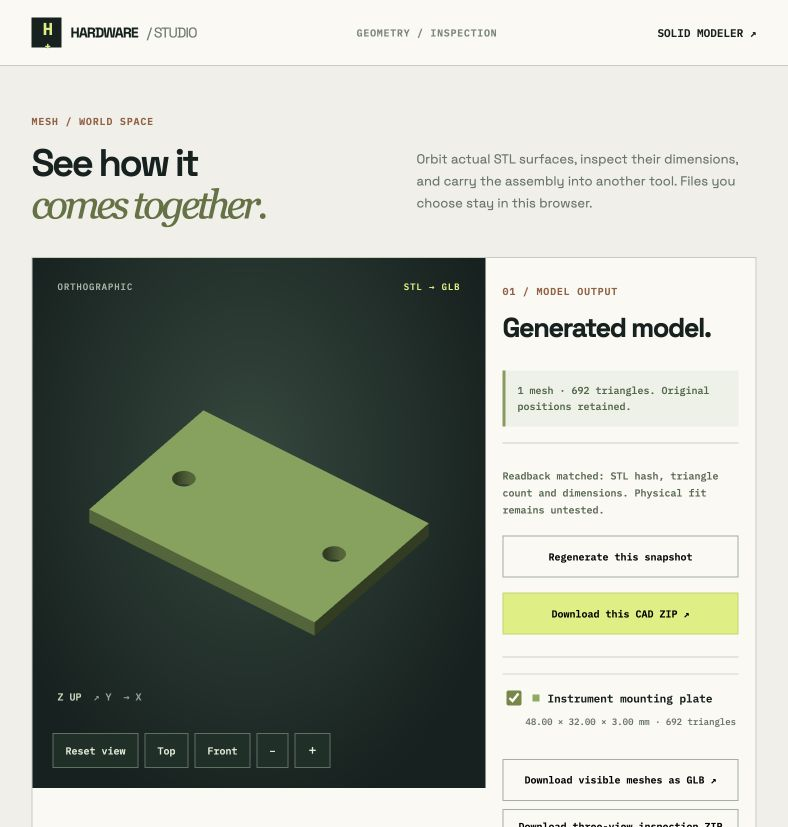

# Original first-part generation

On 23 October 2026, the local browser modeler used the selected installed `qwen3-vl:4b-instruct` model to propose an original instrument plate from explicit dimensions, with no existing solid or example in the creation request. The preserved [proposal](completed/proposal.json) contains the instruction, raw response, normalized result and recorded model identity. This example used no separately billed API.

The actual browser downloads are preserved unchanged as [proposal ZIP](completed/hardware-studio-cad-proposal.zip) and [CAD ZIP](checked-cad/hardware-studio-feature-cad.zip), with their extracted bytes beside them. The CAD archive was downloaded as `hardware-studio-feature-cad (2).zip`; an earlier `(1)` download contained an older concave part and was excluded. Both retained archives passed CRC checks. Replaying the raw response through the intent validator reproduced the stored result, and the proposed and exported source records agree after JSON parsing, including numeric values.

[Independent verification](intent-verification.json) reopened the actual [STEP](checked-cad/solid.step) in a fresh OCP process and checked expectations taken from the user instruction, without using generated probes or build reports. It found one valid solid spanning `(0,0,0)` to `(48,32,3)` mm, exactly six planar faces and two cylindrical faces of radius 2 mm, with +Z axes at `(8,16)` and `(40,16)` mm. Each cylindrical face spans Z = 0–3 mm. Bore cores extending beyond both plate faces had zero material overlap; independent surrounding annuli were entirely material. Volume was **4532.6017763138425 mm³**, versus **4532.601776313845 mm³** from `48*32*3 - 2*pi*2²*3`. Missing-hole and shifted-hole negative controls were rejected; the shifted hole preserves total volume, so the center check supplies distinct evidence.

The model chose **48 mm cutting cylinders** for a **3 mm plate**. Their excess height is harmless for this isolated part because the cut only removes intersecting plate material. It remains a recorded model choice; a later edit with additional material above the plate would need to review the complete cutting features.

Run [verify_intent.py](verify_intent.py) using Python with OCP and an available Node executable:

```sh
python verify_intent.py --negative-checks
```

The checker uses a 0.000001 absolute numeric tolerance. Its expectations are specific to this instruction. It performs a fresh readback with the same OpenCascade kernel used for generation, so it does not prove interoperability with another CAD system. This one successful model trial establishes neither general generation accuracy nor physical fit, strength, safety, manufacturing tolerances or fabrication results.

## Missing dimensions and project context

Two further actual browser trials are preserved separately. The [missing-input proposal](missing-input/proposal.json), downloaded as `hardware-studio-cad-proposal (1).zip`, asked for a new plate without dimensions or hole locations while retaining the earlier valid plate as the captured baseline. The model returned `needs-input`, `spec:null`, and questions covering plate length/width/thickness, hole diameter and hole locations. It exported no proposed source. [Validator replay and archive checks](missing-input-verification.json) passed; the captured `before-source.json` matches the earlier plate. Live browser state preservation is separate evidence.

The [project-context proposal](project-context/proposal.json), downloaded as `hardware-studio-cad-proposal (2).zip`, used only the short instruction “Create the selected part exactly as described in the project brief, with no extra features.” Dimensions came from the captured project brief and explicitly selected target detail; its baseline was null. The model returned a complete plate with 3 mm cutting cylinders. Its separately downloaded [project CAD ZIP](project-cad/hardware-studio-feature-cad.zip), originally `hardware-studio-feature-cad (3).zip`, passed CRC and extracted-byte checks, and its source matches this project proposal.

The distinct [project verification report](project-context-verification.json) checks [that project STEP](project-cad/solid.step), rather than replaying the standalone package. Fresh readback again found one valid 48 × 32 × 3 mm plate, volume **4532.6017763138425 mm³**, two R2 +Z through bores at `(8,16)` and `(40,16)` mm, six planar faces, empty bore cores and complete surrounding material annuli. Run `python verify_followups.py` to reproduce both follow-up reports with the current validator and the existing independent geometric checker. Project return and workspace export are separate browser checks; the same limits on model generality and physical evidence apply.


## Unsupported request and project handoff

The [actual unsupported response](unsupported/proposal.json) rejected essential helical threads and a rounded bolt head with `unsupported` and `spec:null`, without replacing the existing plate. The unsupported request, create mode, selected model and valid prior source survived a browser reload. These sampled responses do not guarantee that every missing or unsupported requirement is detected.

After project-context acceptance, returning through the modeler’s project link showed the saved three-feature part in Assembly. Actual [project JSON](saved-project.json) and [project ZIP](saved-project-package.zip) downloads contain the same `solidSpec` as the project-context proposal and CAD package. The ZIP passed CRC; the original brief and single target part remain, and electrical/mechanical/sourcing review flags are all false. Checked STEP/STL stays in a separate package. The selected target is context only, without an automatic part attachment or solved placement.




The viewer independently matched the returned STL hash, 692 triangles and 48 × 32 × 3 mm mesh bounds, preserving the project modeler return link. The [source proposal view](../../assets/first-part-proposal.png) shows explicit target selection and source review before applying.
