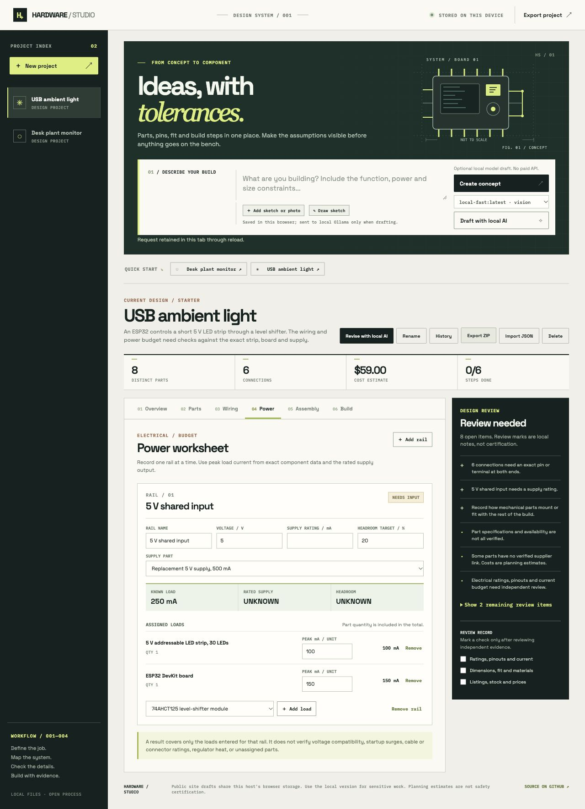

# Manual-edit evidence review

23 October 2026. These are actual browser exports from an isolated local origin. Component names and currents are synthetic test values. No hardware was purchased, connected or tested.

## Reproduced defect and correction

Independent execution of the old production part-save handler replaced the ambient-light starter’s supply while retaining its old 3000 mA rating and completed linked steps. Editing a completed procedure also retained completion. The corrected manual-save path compares the prior and edited records before persistence, including relationships removed by deletion. Failed saves restore the prior project bytes.

In the actual corrected browser flow:

1. Entered test load currents of 100 and 150 mA against the starter’s 3000 mA supply, producing 250 mA known demand and 91.7% headroom. Marked five steps completed.
2. Exported [the prior project](before-project.json), then changed the supply name to `Replacement 5 V supply, 500 mA`. A name is not evidence of an actual rating.
3. The old numeric rating cleared, the worksheet became NEEDS INPUT, and five dependent completed steps reset. Both load currents remained unchanged. The result survived reload.
4. Downloaded [the edited project](after-project.json) and [actual project ZIP](after-package.zip). ZIP CRC passed; its project JSON equals the separate download, review.txt names the missing supply rating and build-plan.txt has no retained completion marks.
5. Removed the supply assignment and explicitly entered 500 mA. Arithmetic showed 50% headroom, but the card stayed ASSIGN SUPPLY with an open source-assignment finding. [That project](unbound-project.json) retains this distinction.

[View the unassigned-supply case](manual-edit-unbound-local.png).

## Repeatable checks

Run `node examples/manual-edit-review/verify-exports.mjs` from the repository root. It checks the actual JSON changes against the current invalidation policy, preserved load currents, completion and the unassigned-source finding, and writes [file hashes and results](export-check.json). The policy replay is not an independent engineering check. The focused tests execute actual production handlers with mocked persistence to test failed saves and retention of unrelated branches, notes and opaque CAD bytes.

The browser smoke case contains no CAD source. Existing CAD retention is checked in the handler tests; prior geometry readback evidence remains in its own worked examples. These checks do not establish electrical, mechanical or physical correctness.
