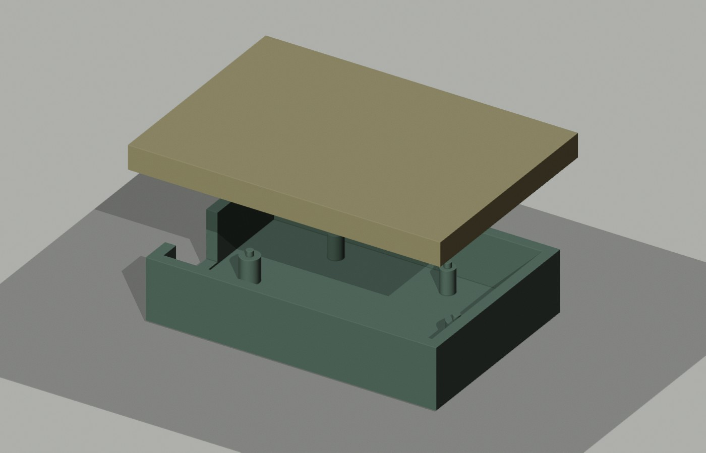
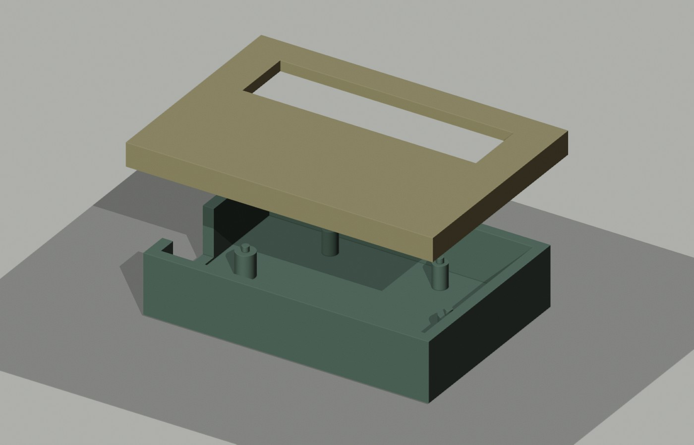

# Pico + NeoPixel prototype tray


This example closes one mechanical gap in Hardware Studio: it supplies an editable, dimensioned **66 × 45 × 14 mm** open tray for a Raspberry Pi Pico Rev3 and Adafruit NeoPixel Stick #1426. The [top layout](preview/layout.svg) marks both board envelopes and six locator pins. A separate [provisional electrical plan](electrical-plan.md) maps the power and data path with its open checks. The [app project](project.json) can be imported to inspect the combined parts, connections and incomplete power worksheet. The [original STEP](generated/v1/tray.step), [STL](generated/v1/tray.stl), [OpenCascade source](model.py), and [Blender scene](preview/tray-scene.blend) are included.

This is a mechanical prototype with a provisional wiring plan, not a complete desk light or fabrication release. The [28-row conductor register](connections.csv) separates proposed +5 V, ground, data, enable and capacitor paths; six rows still lack a named endpoint. The electrical plan proposes an [Adafruit 5 V / 2 A source](https://www.adafruit.com/product/276), [barrel entry adapter](https://www.adafruit.com/product/368), [Pico Micro-B terminal plug](https://www.adafruit.com/product/3972), **two separate** [WAGO 221-415 splices](https://www.wago.com/us/wire-splicing-connectors/compact-splicing-connector/p/221-415), an off-tray [Perma-Proto #1609 board](https://www.adafruit.com/product/1609) and [red](https://www.adafruit.com/product/288)/[black](https://www.adafruit.com/product/290) 22 AWG wire. The WAGO port numbers are project assignments and the PCB rail names do not identify exact holes. Branch ratings, remaining load currents, assembly and physical fit remain open. Separate cover studies exist. A diffuser, verified electrical assembly, auxiliary-electronics placement, cable plug model, retention fasteners, printed fit test and measured production components do not. The tray geometry is original; the manufacturer CAD files used for checking are **linked but not redistributed**.

The importable app project records a partial pin inventory for Pico `GP2`, the [TI SN74AHCT125N](https://www.ti.com/lit/ds/symlink/sn74ahct125.pdf) logic/supply pins, the Stick's [DIN/5VDC/GND pads](https://learn.adafruit.com/elements/3154879/assets/124485/exhibit), and the named adapter terminals. The [Raspberry Pi pinout](https://datasheets.raspberrypi.com/pico/Pico-2-Pinout.pdf) identifies `GP2`. The WAGO and PCB labels in this file are **assembly-assigned labels**, so an internally matched row is still not an exact physical hole map. Matching labels to recorded inventories is an internal consistency check, not a complete schematic or permission to energize the prototype.

## Source evidence, checked 22 October 2026

| Part | Original source | Observed geometry | Scope |
|---|---|---|---|
| Raspberry Pi Pico Rev3 | [Raspberry Pi Pico datasheet](https://datasheets.raspberrypi.com/pico/pico-datasheet.pdf) and [official STEP ZIP](https://datasheets.raspberrypi.com/pico/Pico-R3-step.zip) | Datasheet: 51 × 21 × 1 mm PCB and four 2.1 mm holes. Imported STEP, including connector/component overhang: 52.3 × 21.0 × 3.73 mm. Hole centers in source axes: (4.8, −49), (16.2, −49), (4.8, −2), (16.2, −2) mm. | CAD geometry, not a physical board measurement. |
| Adafruit NeoPixel Stick #1426 | [Product dimensions](https://www.adafruit.com/product/1426) and [official CAD STEP at commit c128bce](https://github.com/adafruit/Adafruit_CAD_Parts/blob/c128bceb1f96b6ea8b68f250bda986ba85da24ea/1426%208x%20NeoPixel%20Stick/1426%208x%20NeoPixel%20Stick.step) | Published dimensions: 51.1 × 10.22 × 3.19 mm. Imported STEP: 50.8 × 10.16 × 2.6 mm, with 1.1 mm radius mounting holes at (12.7, 8.128) and (38.1, 8.128) mm. The tray check uses the larger published length and width and rounds height up to **3.2 mm**. | The model/published differences are retained, not silently treated as agreement. |

The checked reference files had SHA-256 `ea5c693afee3de73e9fcaab1892a5ed44bf789438b9b1e5906e9c4f9859cab8b` (Pico STEP) and `d3066e01e96644b0990469cf4450ab909ef0c8b034a12bd8151320fa33f98522` (Adafruit STEP). The Adafruit Git blob SHA was `7d01cfa7a4bb1495964542b31d05b5a4b06ebad4`. Check the hashes again when using newer files.

## What the geometry check established

The tray has 2.5 mm nominal walls and floor, an open USB-side notch, bosses at the manufacturer model's mounting-hole centers, and 1.6 mm diameter locator pins. Those pins have nominal radial clearances of 0.25 mm in Pico's 2.1 mm holes and 0.30 mm in the Stick's 2.2 mm holes. The [fresh-process fit report](checks/v4/fit-report.json) reopened the exported tray STEP and both manufacturer STEP files. It found:

- A valid, one-solid tray with 66 × 45 × 14 mm overall bounds.
- Zero modeled intersection with either board or between the boards. The closest Pico envelope edge is 1.5 mm from the cavity wall; the **published** Stick envelope stays at least 3.78 mm from a wall.
- The USB wall notch covers the official Pico STEP connector's Y/Z envelope; it has not been checked against a mating cable plug.
- A shifted Pico produced 69.30 mm³ of wall interference. Enlarged locator pins produced 5.78 mm³ and 2.66 mm³ of modeled interference with Pico and Stick. A revised 49 mm wide tray with the Stick moved 4 mm still had zero modeled overlap.

These are same-kernel CAD checks, not independent CAD-system interoperability or physical validation. The USB connector and a mating cable plug were not modeled together. Nominal radial clearance is geometry, not a measured printer tolerance. Try a fit coupon in the intended material and process, then measure real parts and revise the design before fabrication or assembly.

## Lift-off cover geometry study



The optional [cover spec](../../tools/tray-generator/examples/pico-neopixel-cover-study.json) uses the same 66 × 45 × 14 mm tray and left USB-side opening, plus a 2.5 mm plate, 3 mm outside skirt, 2 mm skirt wall and **0.5 mm nominal side gap**. The [generated package](generated/cover-study-v1/spec.json) includes separate [lid STEP](generated/cover-study-v1/lid.step), [lid STL](generated/cover-study-v1/lid.stl), a [top drawing](generated/cover-study-v1/layout.svg) and a [fresh-process report](generated/cover-study-v1/verification.json). The lid has a 71 × 50 × 5.5 mm bounding span in its seated pose. The reader found zero modeled tray/lid volume overlap; shifting it toward the tray by 1.5 mm produced **87 mm³** of modeled interference.

The [editable Blender scene](preview/cover-v3/cover-scene.blend) raises the lid **23 mm above its seated STEP pose for illustration**; it is not the fit-check position.

The [cover fit report](checks/cover-study-v1/fit-report.json) then compared both original maker STEP models at the earlier documented positions against **both** tray and seated lid. It found zero modeled intersections; closest lid separation was 2.27 mm for the Pico model and 3.40 mm for the Stick model. These are nominal model distances, not guaranteed vertical clearances on purchased boards. The source hashes in that report match the earlier tray fit references. The [manifest](fit-manifest-cover.json) can be rerun after downloading the two maker STEP files into a local `vendor/` folder.

This flat cover is a geometry example only. It has **no retention or diffuser** and its opaque plate blocks the NeoPixels, so it is not a finished light. The side skirt inherits the tray notch, but a mating USB plug and its cable bend were not modeled. Printer tolerance, retention, ventilation, access to the Stick, wiring space, temperature and physical fit remain untested. Do not fabricate this as a final enclosure without redesigning those features.

## Open-window cover revision



The [editable open-window spec](../../tools/tray-generator/examples/pico-neopixel-window-cover.json) adds a **54 × 14 mm** aperture at tray coordinates **(6, 27) mm** above the modeled Stick. Its [separate lid STEP](generated/window-cover-v1/lid.step), [STL](generated/window-cover-v1/lid.stl), [dimensioned top drawing](generated/window-cover-v1/layout.svg), [fresh-process verification](generated/window-cover-v1/verification.json), [maker-model fit report](checks/window-cover-v1/fit-report.json) and [editable Blender scene](preview/window-cover-v1/cover-scene.blend) are retained. The new lid remains 71 × 50 × 5.5 mm at its bounding span.

The window removes **1,890 mm³** of plate, equal to `54 × 14 × 2.5`; the independent STEP readback found an empty aperture at the requested position and solid plate beside it. Tray/lid overlap stayed zero at the nominal seated pose, and the shifted-lid negative check still detected **87 mm³** of interference. The original Pico and Stick STEP models had zero modeled interference with the tray or this lid at the saved placements; their source hashes and poses are in the [reproducible manifest](fit-manifest-window-cover.json) and fit report.

This is an **open hole**, not a diffuser. It allows a line of sight to the modeled LED area but does not establish optical performance, eye comfort, weather protection, board access, wire/cable fit, heat behavior or finished enclosure quality. The Blender scene raises the lid 23 mm for illustration; the fit check uses its seated STEP pose. Verify a physical print and actual purchased components before revising this toward a functional light.

## Reusable fit checker

The [new generator package](generated/generator-v1/spec.json) keeps a re-runnable tray spec with its [STEP](generated/generator-v1/tray.step), [STL](generated/generator-v1/tray.stl) and [readback report](generated/generator-v1/verification.json). The generic `tools/tray-generator/fit.py` uses the [nominal manifest](fit-manifest.json) and [shifted-Pico manifest](fit-manifest-shifted.json). Its published [nominal report](checks/generic-fit-v1/nominal.json) found zero modeled tray/component and component/component intersection, with 3.5 mm closest distance between the two component models. The [negative report](checks/generic-fit-v1/shifted-pico.json) detected 69.30 mm³ of Pico/tray interference after moving the Pico 3 mm toward the front wall. These results match the earlier part-specific check's key collision finding without replacing its hole and connector checks.

To reproduce, download the two linked manufacturer STEP files above into a local `vendor/` folder beside these manifests, naming them `Pico-R3.step` and `1426-stick.step`. Check their hashes against the values above. With an OCP-enabled Python, run from the repository root:

```sh
python tools/tray-generator/fit.py --manifest examples/pico-neopixel-tray/fit-manifest.json --out /absolute/path/to/new-fit-report
```

The generic checker reports nominal model collisions and envelope margins. It does not validate mounting-hole alignment, fastener engagement, plug access, tolerances, print process or physical fit.

## Rebuild and recheck

Run `model.py` in a Python environment with OCP (OpenCascade Python bindings). This example was built and checked with OCP 8.0.1.1 and Python 3.12. The output directory must be new:

```sh
python examples/pico-neopixel-tray/model.py --out examples/pico-neopixel-tray/generated/rebuild-new
```

Download the two **manufacturer** STEP sources above to local paths. For Raspberry Pi's ZIP, extract only `Pico-R3.step`. Compare file hashes with this README, then run the fresh reader into another new directory:

```sh
python examples/pico-neopixel-tray/verify.py \
  --tray examples/pico-neopixel-tray/generated/rebuild-new/tray.step \
  --pico-step /absolute/path/to/Pico-R3.step \
  --stick-step /absolute/path/to/1426-stick.step \
  --out examples/pico-neopixel-tray/checks/rebuild-new
```

`layout.py` creates the editable top-view SVG from `design.json`. `render.py` imports our STL in a separate Blender scene and produces presentation previews. Neither renderer changes the STEP geometry or verifies real hardware.
