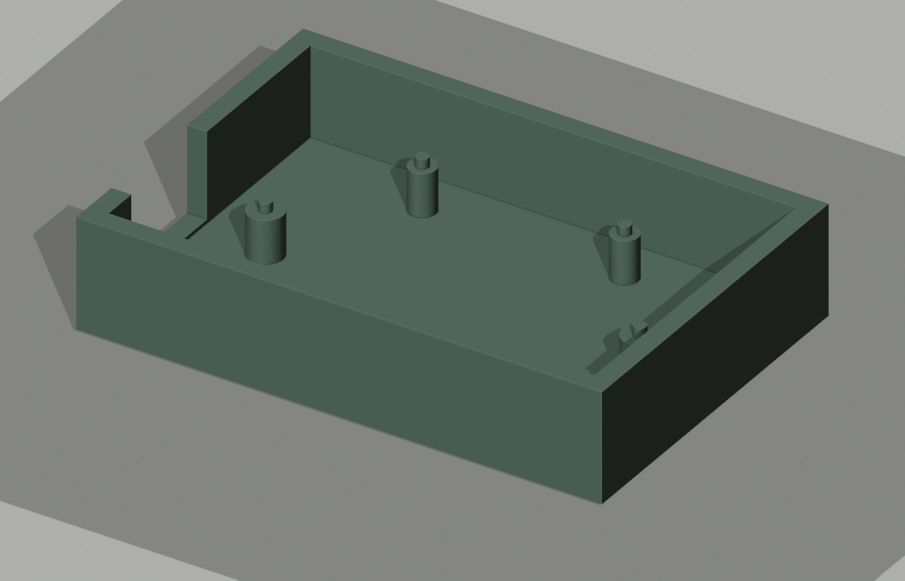

# Pico + NeoPixel prototype tray



This example closes one mechanical gap in Hardware Studio: it supplies an editable, dimensioned **66 × 45 × 14 mm** open tray for a Raspberry Pi Pico Rev3 and Adafruit NeoPixel Stick #1426. The [top layout](preview/layout.svg) marks both board envelopes and six locator pins. The [app project](project.json) can be imported to inspect its parts and open checks. The [original STEP](generated/v1/tray.step), [STL](generated/v1/tray.stl), [OpenCascade source](model.py), and [Blender scene](preview/tray-scene.blend) are included.

This is a mechanical prototype, not a complete desk light or fabrication release. It has no cover, diffuser, verified electrical design, cable plug model, retention fasteners, printed fit test, or measured production components. The tray geometry is original; the manufacturer CAD files used for checking are **linked but not redistributed**.

## Source evidence, checked 22 October 2026

| Part | Original source | Observed geometry | Scope |
|---|---|---|---|
| Raspberry Pi Pico Rev3 | [Raspberry Pi Pico datasheet](https://datasheets.raspberrypi.com/pico/pico-datasheet.pdf) and [official STEP ZIP](https://datasheets.raspberrypi.com/pico/Pico-R3-step.zip) | Datasheet: 51 × 21 × 1 mm PCB and four 2.1 mm holes. Imported STEP, including connector/component overhang: 52.3 × 21.0 × 3.73 mm. Hole centers in source axes: (4.8, −49), (16.2, −49), (4.8, −2), (16.2, −2) mm. | CAD geometry, not a physical board measurement. |
| Adafruit NeoPixel Stick #1426 | [NeoPixel guide](https://learn.adafruit.com/adafruit-neopixel-uberguide/downloads) and [official CAD STEP at commit c128bce](https://github.com/adafruit/Adafruit_CAD_Parts/blob/c128bceb1f96b6ea8b68f250bda986ba85da24ea/1426%208x%20NeoPixel%20Stick/1426%208x%20NeoPixel%20Stick.step) | Published outline: 51.1 × 10.2 mm. Imported STEP: 50.8 × 10.16 × 2.6 mm, with 1.1 mm radius mounting holes at (12.7, 8.128) and (38.1, 8.128) mm. The tray check uses the **larger published envelope**. | The 0.3 mm length difference is retained, not silently treated as agreement. |

The checked reference files had SHA-256 `ea5c693afee3de73e9fcaab1892a5ed44bf789438b9b1e5906e9c4f9859cab8b` (Pico STEP) and `d3066e01e96644b0990469cf4450ab909ef0c8b034a12bd8151320fa33f98522` (Adafruit STEP). The Adafruit Git blob SHA was `7d01cfa7a4bb1495964542b31d05b5a4b06ebad4`. Check the hashes again when using newer files.

## What the geometry check established

The tray has 2.5 mm nominal walls and floor, an open USB-side notch, bosses at the manufacturer model's mounting-hole centers, and 1.6 mm diameter locator pins. Those pins have nominal radial clearances of 0.25 mm in Pico's 2.1 mm holes and 0.30 mm in the Stick's 2.2 mm holes. The [fresh-process fit report](checks/v3/fit-report.json) reopened the exported tray STEP and both manufacturer STEP files. It found:

- A valid, one-solid tray with 66 × 45 × 14 mm overall bounds.
- Zero modeled intersection with either board or between the boards. The closest Pico envelope edge is 1.5 mm from the cavity wall; the **published** Stick envelope stays at least 3.8 mm from a wall.
- The USB wall notch covers the official Pico STEP connector's Y/Z envelope; it has not been checked against a mating cable plug.
- A shifted Pico produced 69.30 mm³ of wall interference. Enlarged locator pins produced 5.78 mm³ and 2.66 mm³ of modeled interference with Pico and Stick. A revised 49 mm wide tray with the Stick moved 4 mm still had zero modeled overlap.

These are same-kernel CAD checks, not independent CAD-system interoperability or physical validation. The USB connector and a mating cable plug were not modeled together. Nominal radial clearance is geometry, not a measured printer tolerance. Try a fit coupon in the intended material and process, then measure real parts and revise the design before fabrication or assembly.

## Rebuild and recheck

Run `model.py` in a Python environment with OCP (OpenCascade Python bindings). This example was built and checked with OCP 8.0.1.1 and Python 3.12. The output directory must be new:

```sh
python examples/pico-neopixel-tray/model.py --out examples/pico-neopixel-tray/generated/rebuild-new
```

Download the two **manufacturer** STEP sources above to local paths. For Raspberry Pi's ZIP, extract only `Pico-R3.step`. Compare file hashes with this README, then run the fresh reader into another new directory:

```sh
python examples/pico-neopixel-tray/verify.py \
  --tray examples/pico-neopixel-tray/generated/rebuild-new/tray.step \
  --pico-step /absolute/path/to/Pico-R3.step \
  --stick-step /absolute/path/to/1426-stick.step \
  --out examples/pico-neopixel-tray/checks/rebuild-new
```

`layout.py` creates the editable top-view SVG from `design.json`. `render.py` imports our STL in a separate Blender scene and produces presentation previews. Neither renderer changes the STEP geometry or verifies real hardware.
