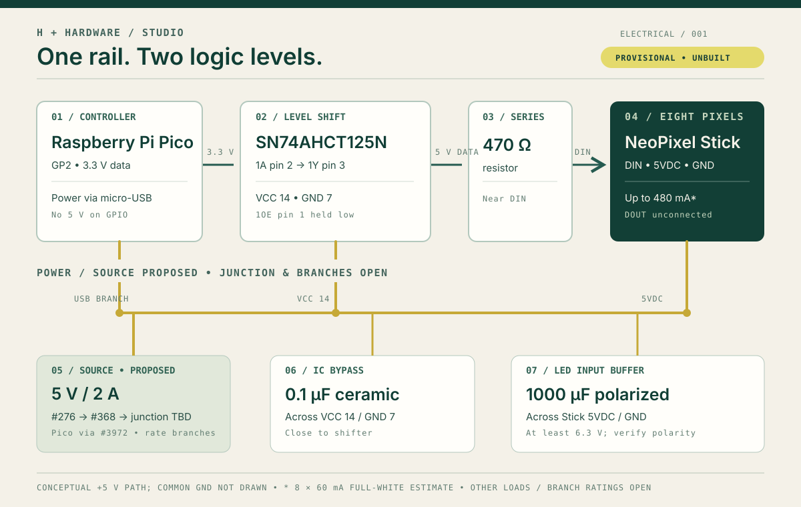

# Provisional electrical plan

This is a **source-backed wiring proposal**, separate from the two-board mechanical fit check. No electrical assembly, supply measurement, signal measurement or physical placement of the auxiliary components has been performed. The [importable app project](project.json) records the same parts, connections and incomplete power worksheet.

## Evidence and decisions

| Decision | Evidence | Design consequence |
|---|---|---|
| Power the eight-pixel Stick at nominal 5 V | [Adafruit product #1426](https://www.adafruit.com/product/1426) specifies 5 VDC and warns the shipped LEDs may be WS2812B or SK6812 based. | Select the exact Stick revision before bench work. Use its marked **input** pads, not DOUT. |
| Budget for full-white LED demand | [Adafruit's power guide](https://learn.adafruit.com/adafruit-neopixel-uberguide/powering-neopixels) gives up to 60 mA per RGB pixel. | Eight pixels yield a **480 mA upper-bound estimate**. This is a design estimate, not measured current. Pico, shifter and harness demand remain unknown. |
| Translate Pico's 3.3 V data | [Raspberry Pi Pico documentation](https://www.raspberrypi.com/documentation/microcontrollers/pico-series.html) identifies 3.3 V logic; [Adafruit's connection guide](https://learn.adafruit.com/adafruit-neopixel-uberguide/basic-connections) recommends a 74AHCT125-class shift for 5 V NeoPixels. [TI's SN74AHCT125 datasheet](https://www.ti.com/lit/ds/symlink/sn74ahct125.pdf) accepts a 2 V high at 4.5–5.5 V VCC. | Proposed Pico GP2 → SN74AHCT125N 1A pin 2, 1OE pin 1 held low, 1Y pin 3 → resistor → Stick DIN. Tie the grounds. Check the purchased IC's package marking and pinout. |
| Dampen the data edge and buffer input power | [Adafruit's power and best-practices guide](https://learn.adafruit.com/adafruit-neopixel-uberguide/powering-neopixels) recommends 300–500 Ω near DIN and 500–1000 µF across LED input power, rated at least 6.3 V. [TI's datasheet](https://www.ti.com/lit/ds/symlink/sn74ahct125.pdf) recommends 0.1 µF bypass close to its VCC pin. | Propose 470 Ω series data resistor, 1000 µF polarized capacitor at the Stick input, and 0.1 µF ceramic across IC pins 14/7. Verify capacitor polarity. |
| Keep power distribution explicit | Raspberry Pi identifies Pico `VBUS` as USB's 5 V input at pin 40; its [datasheet](https://datasheets.raspberrypi.com/pico/pico-datasheet.pdf) explains the USB-to-`VSYS` path. | This plan does **not** route LED current through Pico's `VBUS` header. Separate branches feed Pico micro-USB, Stick and shifter with common ground. |
| Identify a plausible supply and entry connector | [Adafruit #276](https://www.adafruit.com/product/276) lists a regulated, UL-listed 5 V / 2 A positive-tip 5.5/2.1 mm wall supply. [#368](https://www.adafruit.com/product/368) accepts that barrel size and exposes marked +/− screws; [Adafruit support](https://forums.adafruit.com/viewtopic.php?t=141620) calls its rating nominally 2 A. | The app now records **2,000 mA source capacity**, but still reports an incomplete worksheet because Pico and shifter loads are unknown. Confirm the purchased source and polarity. The #368 screws are an entry pair, not a verified three-way junction. |
| Identify the Pico branch connection | [Adafruit #3972](https://www.adafruit.com/product/3972) is a Micro-B male terminal adapter with A = V+ (USB pin 1) and E = GND (pin 5); its listing gives 32.5 × 28 × 10.4 mm dimensions and a 26–16 AWG wire range. | Propose the junction's Pico branch to A/E, then the plug into Pico. Leave data terminals B/C/D disconnected. The listing does not establish an assembly current rating or fit with this tray. |
| Select two separate common splices | [WAGO 221-415](https://www.wago.com/us/wire-splicing-connectors/compact-splicing-connector/p/221-415) is a five-conductor lever splice. WAGO's [model data](https://wago-embedded.customer-domain.wago.com/3d-cad-models/221-485-splicing-connector-with-levers-for-all-conductor-types-max-4-mm-5-conductor-transparent-housing-surrounding-air-temperature-max-85-c-t85-wago?info=wago%2Fpg07%2Fserie221%2F0221-0415_0999-0962.prj) lists 24–12 AWG and an 11 mm strip length for item 221-415. | Propose **one +5 V splice and one GND splice**. Assign one port on each to the #368 feed and three to Pico, Stick and shifter board; leave the fifth empty. Port numbers in this plan are assembly labels, not printed maker terminal numbers. The larger-wire catalog current rating does not establish a 22 AWG assembly rating. |
| Carry only the shifter's local ties on a prototype PCB | [Adafruit Perma-Proto #1609](https://www.adafruit.com/product/1609) is a 51 × 81 mm half-size soldered PCB with four marked power rails. Adafruit [red #288](https://www.adafruit.com/product/288) and [black #290](https://www.adafruit.com/product/290) are 22 AWG solid insulated wire spools. | Feed one +5 V/GND branch pair to the off-tray carrier. Solder distinct holes along its selected rails for AHCT VCC/GND, 1OE and unused input ties. Keep Pico and LED branch current off this board. Exact rail holes, wire lengths, current, voltage drop, solder joints and strain relief remain unchecked. |

For the 14-pin PDIP version of SN74AHCT125N, [TI shows](https://www.ti.com/lit/ds/symlink/sn74ahct125.pdf) VCC at pin 14 and GND at pin 7. The proposal holds `1OE` low and ties unused `2OE`, `3OE`, `4OE`, `2A`, `3A` and `4A` high to VCC, as in TI's example layout; unused outputs stay disconnected. TI separately recommends an OE pull-up when a high-impedance output is needed during power up or down. This always-enabled gate-1 proposal does not provide that behavior, so power sequencing remains an open check. The data line must never feed 5 V into a Pico GPIO. The Stick's DOUT stays disconnected in this one-Stick design.

## Proposed source-to-load path

`#276 barrel center +5 V / sleeve GND → #368 marked +/− → two separate WAGO 221-415 common splices → three separate +5 V/GND branch pairs`:

1. `#3972 A/E → Pico micro-USB`; disconnect any other USB power source before this branch is used.
2. `Stick 5VDC/GND` at the DIN end, with the 1000 µF input capacitor across the same pads.
3. `#1609 Perma-Proto selected +/− rails → SN74AHCT125N VCC 14/GND 7`, with 0.1 µF bypass close to the IC, `1OE` held low and the unused inputs tied high on separate soldered rail holes.

The proposed port assignment on **each** WAGO is `1 source / 2 Pico / 3 Stick / 4 shifter board / 5 unused`. These numbers are installation labels, not printed terminal numbers. Use one stripped conductor per lever opening; never place several branches under one #368 screw. Red/black 22 AWG solid wire is a proposed stationary prototype material, not a validated cable design. The #3972 plug, #368 adapter, both WAGOs and #1609 board are external to the verified tray geometry. Polarity, insulation, strain relief, conductor and contact current, voltage drop, individual rail holes and total assembly current must be checked before energizing.

## Per-conductor review record

The [28-row connection register](connections.csv) separates proposed +5 V, GND, data, enable and capacitor paths. Two rows describe each mated power connector's **electrical continuity**, not extra loose wires. Six rows still lack at least one named endpoint, chiefly at Pico's USB socket, the resistor and the ceramic capacitor. Seventeen other rows use an `ASSIGNED` WAGO port or #1609 rail label and are now flagged **ASSEMBLY LABEL / HOLE UNMAPPED** in the CSV. A named WAGO port is only a project-assigned position; a named #1609 rail is a selected **net**, not an exact solder hole. No row has been continuity-tested or electrically validated. The app's wiring view and project ZIP export this same review register when this JSON is imported.

The two WAGOs resolve connector identity and available positions, but **not** the 22 AWG assembly current rating, connection quality or physical routing. On #1609, choose and record exact holes, verify each intended rail's continuity and check no unintended rail bridge before soldering. The [#3972 maker listing](https://www.adafruit.com/product/3972) supports terminal A = V+ and E = GND; [TI's PDIP pin table](https://www.ti.com/lit/ds/symlink/sn74ahct125.pdf) supports the AHCT labels. Check the marked pads on the delivered [NeoPixel Stick](https://www.adafruit.com/product/1426), because pad order can vary across NeoPixel products.

## Power worksheet

The proposed source lists `2,000 mA`; known LED estimate remains `8 × 60 mA = 480 mA` at full white. The **1,520 mA difference is not verified headroom**: Pico USB and shifter dynamic current are not bounded for this assembly, and the source, connector and junction ratings do not establish voltage at the loads. The app worksheet remains **incomplete** until all load currents are sourced or measured. Record branch and total measurements and retain margin before releasing a build.

## Mechanical interaction still open

Only Pico and Stick are in the current tray STEP fit check. The 51 × 81 mm #1609 board, shifter, two capacitors, resistor, #368 barrel adapter, #3972 Micro-B terminal plug, both WAGOs, wiring and cable bend are **outside that verified geometry**. Keep the carrier and distribution external unless a larger enclosure is modeled and checked. Provide insulation and strain relief, then recheck access, thermal behavior and fit. Do initial unpowered polarity and continuity checks before any current-limited bench test.
