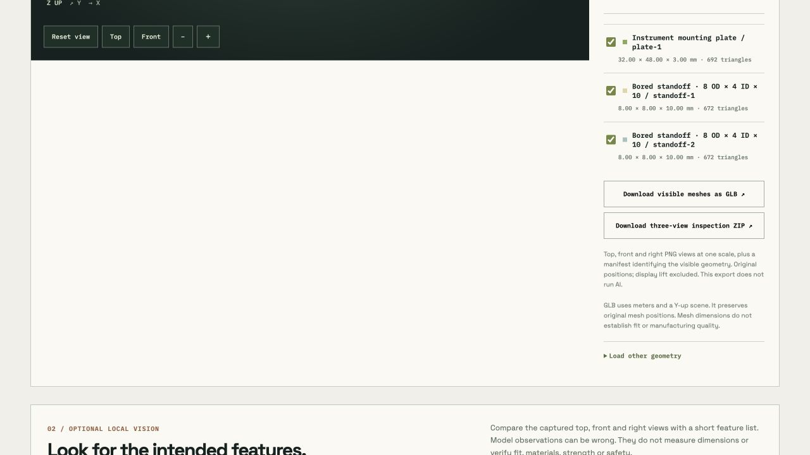
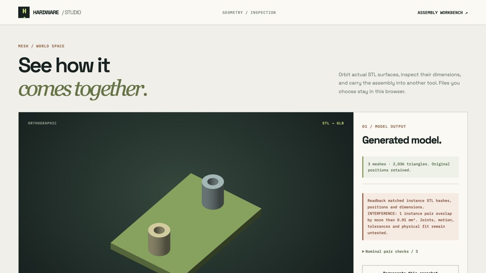

# Editable parts and placed assembly

This original study binds the retained instrument plate to one project part and a dimensioned annular standoff to another. Two standoff instances share their source. It uses free local OpenCascade; no model call or paid API was needed in this assembly trial. The plate source is the earlier recorded local-model result.

## Actual browser path

The [before project](before-project.json) has two part records and the earlier shared plate source, without any assembly. In the isolated local app, the shared source was explicitly copied to the plate part. The bound standoff modeler opened with no inherited source, locked its target, and imported the [specified standoff source](standoff-source.json). Each source remained attached to its own part. The assembly controls then created three named instances and saved their numeric placements.

The plate rotates 90° around its source Z origin, then translates to (32,0,0) mm. The two standoffs are at (16,8,3) and (16,40,3) mm with zero rotation. The [expected source](expected-assembly.json) records these study requirements. The [actual saved source](checked-cad/hardware-studio-assembly-source.json) and [actual CAD ZIP](checked-cad/hardware-studio-assembly-cad.zip) were downloaded from the browser, preserved unchanged and checked for ZIP integrity and exact extracted bytes. Their source records match the expectations after JSON parsing.

## Independent intent check

[verify_intent.py](verify_intent.py) reads the actual exported STEP using direct OCP operations, without importing the generator or using its reports as expected geometry. [Results](intent-verification.json) confirm:

- Three valid, unfused solids in a **32 × 48 × 13 mm** compound.
- Rotated plate bounds (0,0,0) to (32,48,3) mm and two R2 +Z bores at world (16,8) and (16,40).
- Two R4/R2 annular standoffs, each10mm high, at their requested world positions.
- Volume **5286.58401317542 mm³**, matching the independently calculated plate plus two annuli.
- Recomputed overlap volumes0,0,0mm³ and distances0,0,24mm. Zero distance describes nominal contact.
- Moved-standoff and extra-90°-plate controls preserve volume and are both rejected by placement/feature checks.

Run with OCP-enabled Python:

```sh
python verify_intent.py
```

The viewer matched three STL hashes, **2036 triangles** and all absolute bounds. It retained source/instance names and the project assembly return link. GLB and inspection exports use these transformed mesh positions.



[Workbench](../../assets/placed-assembly-workbench.png) shows exact part bindings and explicit placement controls. These are sampled software/geometry results. Sources and readback share the OpenCascade kernel; they do not prove another CAD system’s interoperability, physical fit, joints, motion, material suitability, loads, fasteners, manufacturing clearance or fabrication.


## Interference, history and portable exports

The browser trial then lowered only standoff1 from Z3 to Z2. The [actual interference package](interference/hardware-studio-assembly-cad.zip) retained its full source and geometry; the viewer displayed an explicit INTERFERENCE warning. [Direct recomputation](interference/independent-check.json) found **37.699111843078256 mm³**, matching **12π mm³** for the1mm annular intrusion. [check_interference.py](interference/check_interference.py) reopens the ZIP’s STEP files without trusting its pair report. Other instance pairs remain unchanged.



The studio’s latest **Before updating CAD source** History entry restored the valid Z3 placements. Actual [restored project JSON](restored-project.json) and [project ZIP](restored-project-package.zip) match the expected assembly, original parts and shared plate source, with all review flags false. The ZIP includes matching `assembly-spec.json` and both `cad-sources/part-001.json`/`part-002.json` sources.

The actual [GLB](placed-assembly.glb) retains three nodes with every vertex position matching the placed STL after conversion to meters and the documented Y-up scene basis. The [inspection sheet](inspection/inspection.png) and [manifest](inspection/inspection.json) identify the same three transformed meshes. [Export checks](export-verification.json) confirm2036triangles and world bounds32×48×13mm.

An empty numeric coordinate survived reload in the structured controls and blocked Apply/generation. Discard returned to the valid source. Raw JSON is retained separately and cannot be overwritten by structured edits until explicitly read/discarded. The390px iframe preview showed stacked source/instance controls and all three coordinate columns within the frame; no physical-phone test is claimed.
