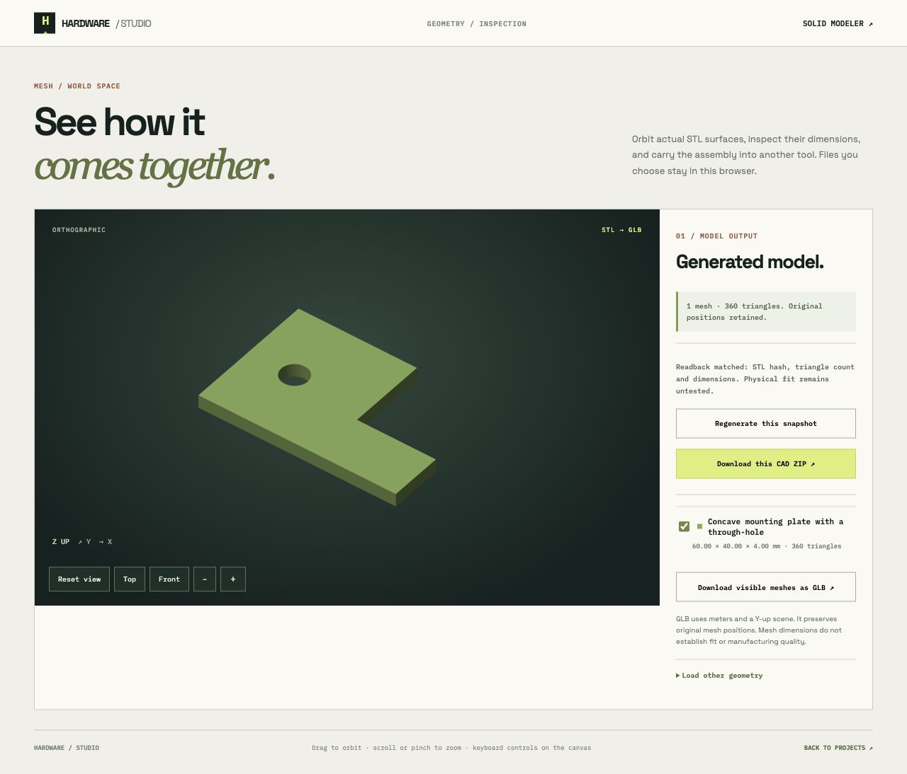
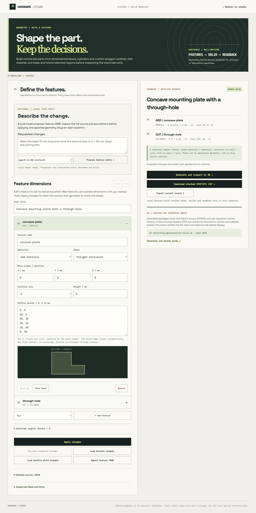

# Concave profile plate

Original Hardware Studio data-only polygon extrusion example, 23 October 2026. The source is [profile-plate.json](../../tools/solid-generator/examples/profile-plate.json). It defines a 60 × 40 × 4 mm plate with a 24 × 24 mm corner removed from its outline, plus one 3 mm radius through-hole. It retains a triangular material region, a rectangular void in the concavity and a triangular void in the hole as selected checks.

Import [the editable project](project.json) into the studio, then open Assembly → feature solid modeler. It retains the 3 mm-radius baseline source and deliberately unverified part/build review. The separate model-edit package records the later 4 mm-radius trial.

## Evidence

- [Generated source](generated/spec.json), [STEP](generated/solid.step), [STL](generated/solid.stl), [build history](generated/build-report.json) and [fresh-process readback](generated/verification.json).
- Independent expected base volume: `(60*40 - 24*24)*4 - pi*3^2*4 = 7182.902664470767 mm³`. Build and STEP readback agree within 0.00001 mm³. This formula checks overall material volume, not all geometric intent.
- The Python regression suite exercises the concave plate and the corresponding profiles on +X/+Y/+Z, profile cuts, clockwise input normalization, invalid crossings/touches, and a separate triangular prism with eight STL triangles. JS/Python source normalization is compared over accepted and rejected fixtures.
- [Actual local model edit](model-edit/trial.json): `qwen3-vl:4b-instruct` changed only the through-hole radius from 3 to 4 mm. Every other normalized source field, including outline and probes, remained identical. The actual browser CAD download passed ZIP integrity, source and SHA checks. Its independently expected volume is `7094.938070170253 mm³`.
- The edited [STEP](model-edit/solid.step), [STL](model-edit/solid.stl), [source](model-edit/spec.json), [build history](model-edit/build-report.json) and [readback report](model-edit/verification.json) are retained. The browser viewer displayed one mesh, 360 triangles and 60 × 40 × 4 mm bounds.

## Limits

This is one successful model edit, not a model-quality benchmark. The outline control shows the supplied polygon before booleans; it does not preview the final solid. STEP writer and reader use the same OpenCascade kernel. No physical fit, material strength, manufacturing tolerance, curved sketch interpretation or independent CAD-system interoperability was established. Profiles contain one simple straight-edged ring, with holes added through separate cuts. They do not provide freeform sketch reconstruction, constraints, fillets, lofts or assemblies.
