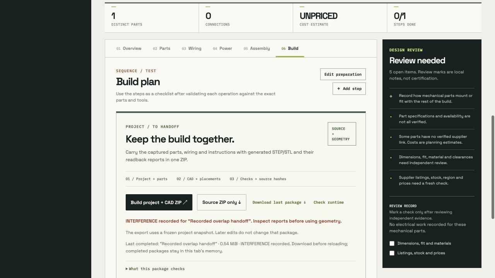

# Captured project and checked CAD handoff

This example retains two actual browser downloads from the project package flow. Each ZIP contains the complete captured planning record, its original source ZIP, all three requested CAD branches, and the generated readback reports. No unpacked meshes are duplicated here.


## Files and snapshot history

- `actual-browser-bundle.zip`: first completed browser download, captured at `2026-10-24T01:19:57.395Z`.
- `retained-captured-bundle.zip`: separate completed generation, captured at `2026-10-24T01:21:33.412Z`. Its download retained the captured record after a later workspace note edit.
- `before-project.json`: the original input before browser import. Import assigned a new project ID, starter label and timestamps. Content matches the captured record apart from those four fields.
- `captured-project.json`: the exact `project.json` bytes in both completed downloads, ready for inspection or import.
- `after-project.json`: the later workspace record. Only `notes` and `updatedAt` differ from the captured record. The captured ZIP keeps the original note.
- `verify_handoff.py`: archive and independent nominal STEP inspector.
- `verification.json`: retained output from a successful full inspection of both actual ZIPs.
- `interference-bundle.zip`, `interference-manifest.json` and `interference-verification.json`: actual browser package and readback for a separate deliberately overlapping assembly.
- `browser-failure-retention.json`: captured browser receipt for a failed rebuild and unchanged previous completed download. The two duplicate successful-download files described in this receipt are not separately copied here.

The two nested `captured-source.zip` files are distinct byte captures because their export timestamps differ. Each is checked against its own pinned SHA-256 digest, manifest and exact source entries. The two outer packages also differ in generated STEP headers and elapsed verification timings. These are separate runs, not byte-identical downloads.

## Failed builds and nominal interference

The deliberately rejected `miss` cut changed no volume and failed generation. The browser retained the prior completed package; the successful download before and the download after the failed rebuild had identical SHA-256 `73e534a0e549814b75a5a062d7bcf88ae534d9bf81ba4b96f08d5af3502b1f5d`. This is recorded browser evidence in `browser-failure-retention.json`, not a replay performed by the independent verifier. No partial package was downloaded.

A separate actual download places `tab-1` and `tab-2` at the same location. Its manifest and readback both report **interference**, while preserving all three branches and five instances. The retained pair report records **4,093.542870 mm³** of common volume. The full independent inspector reads those two actual instance STEP files and recomputes their common volume directly with OCP. It does not turn interference into a passed physical-fit claim.



## What was captured

All three requested geometry branches are present:

1. **Tray and cover:** 66 × 45 × 14 mm tray with six locator bosses and one side opening; separate lift-off cover with a 54 × 14 mm window. Independent integrated nominal volumes are approximately **13,556.364475 mm³** and **8,293 mm³**.
2. **Shared solid:** an exact 40 × 20 × 6 mm capsule pull tab, D6 through-bore at (10,10), and R1 round on the complete top outer perimeter. The bore and bottom outer edges stay unrounded. Independent analytic volume is approximately **4,093.542870 mm³**.
3. **Part-bound assembly:** one source asset bound to BOM part ID `curved-tab`, quantity five. Instances `tab-1` through `tab-5` are translated by 0, 50, 100, 150 and 200 mm along X, with zero rotations. The assembly contains five solids, spans **240 × 20 × 6 mm**, and has nominal total volume approximately **20,467.714349 mm³**.

Tray and shared solid remain project-level branches without part bindings. They are not one fitted build with the five tabs. The parts list, build step, review flags, source sequence, diagrams and planning limitations are preserved in the ZIP. The generated tray spec adds explicit `holeRadius: null` fields for the six mounts; the original source entries remain byte-for-byte intact.

## Reproduce verification

From the repository root, verify ZIP CRCs, all manifest hashes and lengths, the pinned original captures, source bindings and snapshot differences using ordinary Python:

```sh
python3 examples/project-cad-handoff/verify_handoff.py --archives-only
```

For actual STEP inspection, use the repository's free local CAD runtime after following `tools/cad-runtime` setup instructions:

```sh
.cad-runtime/bin/python examples/project-cad-handoff/verify_handoff.py
```

Optionally save a fresh report to a chosen file with `--output /absolute/path/report.json`. The script does not alter retained examples by default, access workspace storage, call a model, or generate replacement CAD.

The full check imports the sibling [`curved-pull-tab/verify_intent.py`](../curved-pull-tab/verify_intent.py) analytic inspector. It imports no Studio builder or package verifier. For each run it reads ten STEP files: the shared tab, bound asset, five placed instances, combined assembly, tray and cover. It checks the curved tab's planes, circles, cylinders, tori, face areas, bore location, top rounding and ten explicit material/void regions, including each solid in the combined assembly. Tray and cover receive independent bounds and integrated-volume checks. It does not independently inspect every tray boss location or port face.

## Evidence and limits

- Each outer ZIP has **46 entries**, including **45 manifest-hashed files**. Every file length and SHA-256 is checked; the manifest excludes its own circular digest.
- Each nested source ZIP has **13 entries**, all identical to the corresponding source entries in its outer package. The exact nested ZIP bytes are separately pinned.
- The saved server reports contain sampled mesh-to-STEP comparisons for the tray, cover, shared solid, bound asset and five instances. This independent script checks their recorded presence and consistency. It does **not** rerun those sampled mesh comparisons.
- Fresh STEP inspection uses the same OpenCascade kernel family as generation. It provides independently derived nominal checks, not a different-kernel interoperability result.
- The archives and screenshot establish this retained workflow example. They do not prove general model reliability or every application path.
- Physical fit, manufacturing tolerances, material, strength, electrical behavior, supplier availability and hardware assembly remain unverified.
