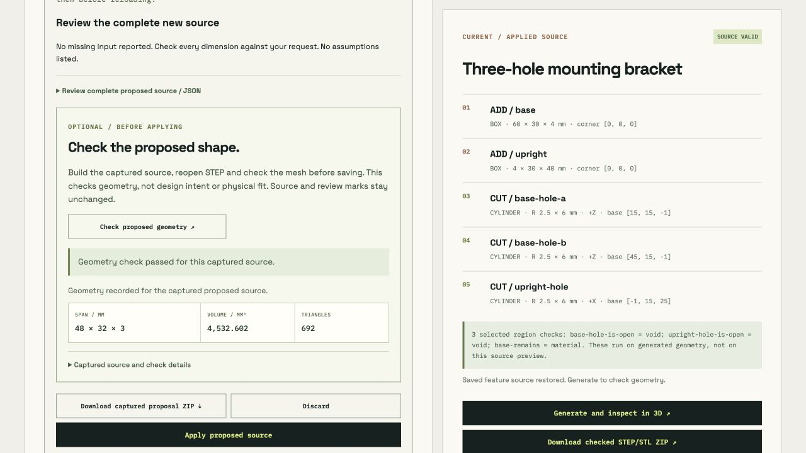

# Check a proposal before applying it

This retained trial separates a model proposal, a geometry check, and the current working source. On 23 October 2026 local time, the installed `qwen3.8:27b` model proposed a **48 × 32 × 3 mm plate with two 4 mm through-holes**, centered at **(8,16)** and **(40,16) mm**. The instruction specified the lower corner at (0,0,0) and no other features. The recorded model digest is in the proposal; its identity was checked before and after generation. This was one actual local model response, with no paid API.

## What was captured

| Artifact | Evidence |
| --- | --- |
| [First checked proposal ZIP](first-checked-proposal.zip) | Original browser download: request, model identity, raw model response, normalized proposal, baseline, exact prepared source, raw successful HTTP response, check receipt and verified STL. |
| [Final checked proposal ZIP](final-checked-proposal.zip) | A separate actual model generation and geometry check using solid UI 17 and proposal checker 2. Its own capture time, raw HTTP response and receipt are retained. |
| [Final working source](final-working-source.json) and [final browser observations](final-browser-check.json) | Actual post-check working-source export, version observations and recorded receipt from the final trial. The bracket remains byte identical to the initial export and the proposal was not applied. |
| [Later stale proposal ZIP](first-stale-proposal.zip) | Download after the instruction changed. Every ZIP entry has the same name and bytes as the first capture. The two ZIP containers need not have identical timestamps or bytes. |
| [Before source](before-source.json) and [after-check source](after-check-source.json) | Actual working-source exports are byte identical. The original three-hole bracket was still current; the plate was not applied. |
| [Browser observations](first-browser-check.json) | Recorded observations that later instruction edits disabled Apply and Check, preserved the captured evidence, and left the working source unchanged. These UI observations cannot be inferred from ZIP hashes alone. |
| [Rejected check ZIP](rejected-check.zip) and [receipt](rejected-receipt.json) | A deliberately supplied missed cut, outside all plate material, was rejected by the local CAD runtime with HTTP 422. It retained source and a rejection receipt, with no verified mesh. This is a checker control, not another model success. |
| [Separate full CAD ZIP](first-proposed-cad.zip) and [binding](full-cad-binding.json) | Generated afterward through the existing HTTP `/api/solid` endpoint from the first capture's exact prepared source, without applying it. Its STL is byte identical to the preview mesh. Its fresh STEP supports the separate native inspection below. This ZIP was not the proposal preview's browser download. |

The first browser trial used **solid UI version 16 and proposal checker version 1**. The [verification report](verification.json) records those versions. A later application revision or rerun does not retroactively change the code that produced these first artifacts.

The distinct final trial used **solid UI version 17 and proposal checker version 2**. Its separately recorded request and `qwen3.8:27b` response passed the check, again producing 692 triangles, 48 × 32 × 3 mm bounds and zero model-generated probes. Its prepared source and final STL are byte identical to the first capture and the separate full CAD case. Therefore the independently inspected STEP below is bound to both trials' exact source and matching STL. The verifier checks those identities rather than assuming a shared instruction implies shared output. The final raw HTTP response has its own SHA-256, `f50cdff4a14de67c1095fce05d6123104dacd3f3963918ca36dc07321db8023a`.



[Narrow static layout review](narrow-layout.jpg) shows the completed-result DOM at 390 px with the current stylesheet: both viewport and content measured 390 px, with no horizontal overflow. Scripts were removed from that captured DOM and it was served in a static iframe. This is layout evidence, not a fresh mobile interaction or another native CAD job.

## What passed

The model returned three features and zero generated probes: one 48 × 32 × 3 mm box and two +Z cutting cylinders of radius 2 mm and height 3 mm. The original model response, normalized proposal, proposed-source export, prepared request source and returned preview source agree after parsing. Production validator replay reproduces the normalized result.

Both trials' prepared source SHA-256 is `acf12227862ec6d3340ff463ff740a72c7136674cc8d899e94b0b10c7e3ba796`. The returned STL is **34,684 bytes**, **692 triangles**, with bounds **(0,0,0)–(48,32,3) mm** and SHA-256 `eb4414280973445819f612361ee163f2fcfd27e351af324b0c6179fcddbc4cef`. Each exact HTTP response is preserved and matches its own receipt hash. Replaying the current production intent and mesh validators passed independently for both trials.

Independent native inspection reopens only the separately generated, source-matched STEP. It uses the sibling plate example's `check_step` function because the explicit geometric instruction is the same. It does not run that example's main function or reuse its STEP files or reports. The inspection found one valid solid, exactly six planar faces and two cylindrical faces of radius 2 mm, with +Z axes at the requested hole centers and surfaces spanning Z = 0–3 mm. Independent bore-core intersections are empty; surrounding annuli contain the expected material. Volume is **4532.6017763138425 mm³**, agreeing with `48*32*3 - 2*pi*2²*3` within the 0.000001 mm³ absolute tolerance.

## Reproduce offline

Archive checks need only ordinary Python and its standard library:

```sh
python3 examples/proposal-geometry-check/verify_evidence.py --out /tmp/proposal-archive-verification.json
```

To also replay the current application intent and mesh validators, use an existing Node executable:

```sh
python3 examples/proposal-geometry-check/verify_evidence.py --production-replay --out /tmp/proposal-replay-verification.json
```

To add fresh STEP inspection, use Python with the existing OCP CAD dependency:

```sh
.cad-runtime/bin/python examples/proposal-geometry-check/verify_evidence.py --production-replay --native --out /tmp/proposal-native-verification.json
```

Run these commands from the Hardware Studio repository root. They make no model or network requests, do not apply a proposal, and do not read or change browser storage. Native inspection writes the retained STEP into a temporary directory and removes that temporary copy afterward. ZIPs remain the only retained copies of mesh and STEP payloads.

## Limits

The browser checks source equality, hashes, mesh bounds and triangle counts, together with the returned native verification report. It does **not** independently recompute STEP topology. The proposal preview endpoint supplies **no STEP or raw pre-normalization STL file**; the separate full CAD archive must not be confused with preview evidence. Its STEP hash differs from the earlier preview's declared STEP hash because it is a later export, while the source and final STL match exactly.

The native check uses the same OpenCascade kernel as generation, rather than another CAD system. Native sampled mesh/STEP distance checks are not an exhaustive surface-distance or self-intersection proof. These two successful trials of the same plate instruction are not a model-accuracy benchmark, an exhaustive check of arbitrary user intent, or evidence of physical fit, manufacturing tolerances, material strength, fabrication quality or electrical safety.
